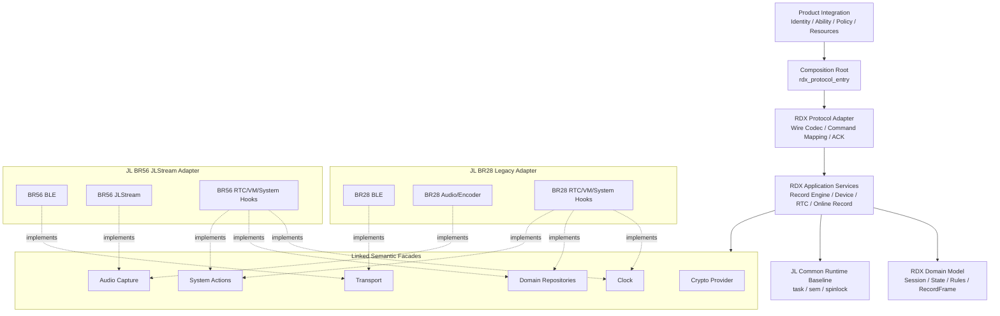

# RDX 同生态跨芯片跨 SDK 架构设计

> 状态：最佳实践复核稿，待评审冻结
>
> 日期：2026-08-26
>
> 适用对象：AC701N/BR28 参考工程与 AC710N/BR56 Type-C 工程

## 1. 文档目的

本文定义 RDX 在同一 JL 生态内跨芯片、跨 SDK 代际复用时的目标架构。当前需要处理的不是 JL 与 STM32、ESP32 等异构平台之间的通用移植，而是：

- 参考工程使用 AC701N/BR28 及其旧版 SDK；
- 当前 Type-C 工程使用 AC710N/BR56 及新版 SDK；
- 两边的 BLE、任务、VM、RTC 等基础 API 存在相似部分；
- 两边的音频框架、产品生命周期和业务集成方式存在明显差异；
- RDX Wire 协议、鉴权、设备状态、会话和录音业务语义应尽量保持一致。

本文回答以下问题：

1. 哪些 RDX 代码应成为跨芯片共享核心；
2. 哪些差异必须留在各 SDK Adapter 中；
3. 是否需要 HAL、OSAL、vtable 或条件编译；
4. 产品 Ability、SDK 能力和运行时资源如何保持一致；
5. 当前工程如何渐进演进，而不重新引入参考工程的强耦合结构。

本文只冻结目标边界和迁移原则，不表示目标架构已经全部落地，也不改变现有硬件行为。

## 2. 与现有文档的关系

本文继承以下已有决策：

- [99.嵌入式跨平台设计模式.md](./99.嵌入式跨平台设计模式.md) 中关于 Wrapper、vtable、OSAL、构建选择和避免过度抽象的原则；
- [3-3.RDX录音基础设施架构优化方案.md](./3-3.RDX录音基础设施架构优化方案.md) 中 Record Engine、Destination、TX Scheduler、资源租约和状态所有权边界；
- [5-1.RDX新静态库全量业务移植前边界加强方案.md](./5-1.RDX新静态库全量业务移植前边界加强方案.md) 中“本地 RDX 协议与业务实现 + 静态库仅作为加密 Provider”的决策。

本文不改变以下约束：

- 不允许本地 RDX 与参考静态库业务双栈运行；
- 不因跨芯片抽象而新增静态库业务符号或 archive member；
- 不把参考工程的当前实现直接定义为 Golden Behavior；
- 不让 USB、音频、BLE 等 JL 公共模块反向依赖 RDX 业务；
- 不修改独立的 `t2616cc-firmware/` 参考工程来配合当前工程构建。

如果后续决定由供应方静态库重新接管完整协议或业务，必须另行进行架构切换评审，不能作为本文 Adapter 的一种实现渐进接入。

## 3. 结论先行

针对 AC701N/BR28 与 AC710N/BR56，复核后推荐采用：

> RDX 领域模型 + 应用服务 + 窄语义接口 + 构建期 SDK Adapter + 产品装配层

具体决策如下：

1. 不建设覆盖整个 JL SDK 的通用 HAL；
2. 不把参考工程的 `rdx_app.c`、`rdx_record.c` 或 `rdx_ble_server.c` 直接改造成公共核心；
3. 领域模型只表达状态、规则和不变量；Wire 编解码属于 Protocol Adapter，Record Engine 属于应用编排，不把两者误称为纯领域核心；
4. BR28 旧 SDK 和 BR56 新 SDK 分别实现同一组窄语义端口；
5. 每个固件在构建时只选择一套 SDK Adapter，不进行运行时芯片切换；
6. 单实现 Port 默认使用“同名接口 + 构建选源 + 链接期缺符号失败”，不为 BR28/BR56 切换引入运行时 vtable；
7. 只对真实运行时多态保留 vtable，例如 Record Destination，以及未来确实同时存在的 Source/Backend；
8. Product Ability、Compiled Capability、Boot Structural Capability 和 Operational Readiness 分层；
9. 参考工程只作为业务需求、Wire 兼容和异常场景的证据来源；可复用行为必须先转写为公共合同和测试；
10. 先在当前工程收敛边界并完成第二套 Adapter，再提取唯一来源的共享组件，避免过早形成抽象包。

### 3.1 最佳实践复核结论

本场景只有两个已知 SDK 家族，而且芯片在构建时已经确定。最佳实践不是抽象层最多，而是让变化只能发生在少数文件，同时让漏实现尽早失败。

| 方案 | 复核结论 | 原因 |
| --- | --- | --- |
| 在业务代码中散布 BR28/BR56 `#ifdef` | 不采用 | SDK 差异会扩散，新增业务需要同时修改多处 |
| 建设完整 JL HAL/OSAL | 不采用 | 两套 SDK 同属 JL 生态，抽象范围远大于 RDX 真实需要 |
| 所有 Port 都放进运行时 vtable Manifest | 不作为默认方案 | 固件不会运行时切换 SDK，增加装配、NULL 检查和 ABI 管理成本 |
| 同名语义接口 + 构建选源 + 链接期绑定 | 默认采用 | 零运行时分派，缺少必需实现时链接失败，最符合当前规模 |
| Record Destination 等真实运行时策略使用小 vtable | 保留 | 同一固件内确有多实现、多实例或 fake 注入价值 |
| 直接复制一份共享代码到两个工程 | 不采用 | 修复和协议演进会形成永久分叉 |

因此，本文使用“Port”表示稳定语义边界，不等于必须用函数指针表实现。Port 的默认 C 实现是普通函数声明，由构建系统选择唯一实现文件。

### 3.2 可移植性承诺边界

目标架构成立后，可以把新 JL 芯片的主要移植工作收敛到 SDK Adapter 和 Product Integration，但不能承诺“只要函数名对上就无条件运行”。准确表述是：

> 只要目标芯片满足目标 RDX Ability 所需的结构能力、资源预算和时序语义，并且对应 SDK Adapter 通过合同验证，就可以复用同一套 Domain Model、Application Service 和 Protocol Adapter。

不同目标的接入成本分为：

| 目标情况 | 接入方式 | 预期工作量 |
| --- | --- | --- |
| 芯片属于已有 SDK/API 家族，能力和语义一致 | 复用现有 Adapter，新增 Product Integration 和配置 | 低 |
| 芯片属于新 SDK/API 家族，但能力完整 | 新增一套 Adapter，公共业务不分叉 | 中 |
| 缺少某个可选业务能力 | 关闭对应 Ability，不编造空实现 | 取决于剩余业务 |
| 缺少 RDX 基础必需能力或资源预算 | 不能启用 RDX，或必须先改变产品需求 | 不可直接移植 |

“满足 Port”至少包含五类合同：

1. **接口合同**：类型、错误分类、幂等和生命周期入口完整；
2. **语义合同**：例如 Notify 返回值只代表传输接纳，callback generation 和 buffer 所有权一致；
3. **结构能力合同**：BLE、Audio、Clock、Repository、Crypto 及工具生成资源真实存在；
4. **非功能合同**：RAM、Flash、任务栈、实时吞吐、队列容量和启动/退出 deadline 满足目标业务；
5. **共存合同**：USB Audio、BLE、RTC、VM、Power 和录音资源仲裁在目标产品上成立。

因此，“任何 JL 芯片都能轻松移植”应理解为架构把变化集中并使工作量可预测，而不是免除每颗芯片的 Adapter 实现、能力审查和目标硬件验证。

## 4. 现状对比与问题定位

### 4.1 参考工程

参考工程位于：

    t2616cc-firmware/SDK/apps/common/third_party_profile/rdx_protocol/

其主要特征是：

- `rdx_app.c` 同时包含 App、BLE、TWS、Audio、ANC、Power、GPIO、VM、Battery 等大量 JL 头文件；
- `rdx_record.c` 同时拥有录音状态、定时器、任务、Mic Gain、BLE 发送判断及旧音频编码路径；
- `rdx_ble_server.c` 同时处理 GATT、连接状态、协议协作、VM、录音和电源策略；
- `rdx_vm.c` 除持久化外还依赖 BLE、TWS、Record、RTC 和协议状态；
- 业务模块通过全局状态、`extern`、定时器和 SDK 对象相互访问。

这种结构能够在单一产品内工作，但不能通过少量 `#ifdef CONFIG_CPU_BR28/BR56` 安全变成公共模块。若直接跨芯片复用，会出现以下问题：

- SDK 差异扩散到所有业务文件；
- 同一状态出现多个所有者；
- 参考工程中的产品策略被误带入 Type-C 产品；
- 编译通过不能证明资源、回调上下文和错误语义一致；
- 后续任一产品修复都会形成双份甚至多份分叉。

### 4.2 当前 AC710N/BR56 工程

当前工程已经完成部分正确分层：

- `rdx_mvp0_protocol.c` 承担 Wire 解析和命令处理；
- `rdx_record_engine.c` 承担录音会话和采集生命周期；
- `rdx_record_audio_br56.c`、`rdx_record_call_audio_br56.c` 承担 JLStream 适配；
- `rdx_ble_transport_br56.c` 承担 GATT/ATT 适配；
- `rdx_record_destination_ops` 已表达输出目的地的真实业务可插拔性；
- `rdx_integration_config.h` 已把 Ability、源码门控和资源依赖关联起来。

但当前仍存在以下跨 SDK 阻碍：

- Protocol 直接包含 `rdx_ble_transport_br56.h` 和 `rdx_platform_br56.h`；
- Record Engine 直接包含并调用 BR56 Audio Adapter；
- 公共头文件普遍通过 `system/includes.h` 获得 `u8/u16/u32` 等类型；
- Record Engine 直接使用 `spin_lock`、`task_create` 和 `os_sem_*`；
- RTC Service 同时实现时间业务策略、硬件 RTC 和 VM 读写；
- Device State Service 直接拥有 `syscfg_*` 持久化细节；
- `RDX_CFG_IMPLEMENTED_ABILITY` 目前表达的是单一目标工程能力，尚未区分产品声明与 SDK Adapter 能力。

因此，当前工程适合作为共享核心的演进起点，但不能简单将文件名中的 `_br56` 删除后宣称跨芯片完成。

### 4.3 差异强度判断

| 领域 | BR28 与 BR56 差异 | 推荐处理 |
| --- | --- | --- |
| Wire 协议、鉴权、命令状态 | 原则上低 | 分别进入 Protocol、Application 和 Domain |
| Record Session、状态、错误 | 原则上低 | 进入共享 Domain/Application |
| BLE GATT/ATT API | 中等，接口相似但事件和发送语义需核对 | Transport Adapter |
| VM/syscfg 基础 API | 表面相似，ID、对象布局和校验策略不同 | Domain Repository Adapter |
| RTC | API 相似，初始化、信任和备份策略需拆分 | Clock Adapter + RTC Service |
| 任务、信号量、Timer | 中等，名称和生命周期接口存在差异 | 最小 Runtime Adapter |
| 音频采集和编码 | 高，旧编码路径与 JLStream 模型不同 | 完整 Audio Capture Adapter |
| TWS、Battery、Charge、LED、Key、Power | 高度产品相关 | Product Integration，不进入共享 Domain/Application |
| 资源文件和音频流程 | 高度工具与产品相关 | 产品资源 + Adapter 运行时探测 |

## 5. 统一术语

### 5.1 RDX Domain Model

RDX Domain Model 是不依赖芯片、SDK、Wire 格式和产品模式的状态、规则与不变量集合，包括：

- 鉴权状态及授权规则；
- Record Session、Session Controller 和 Capture Generation；
- RecordFrame、有效时间轴、状态转换和错误分类；
- Device State 中与持久化方式无关的约束。

Domain Model 应尽量是确定性的普通 C 逻辑：输入命令或事件，输出状态迁移、领域事件或拒绝原因。它不创建 JL Task，不访问 Port，不编解码 Wire，不访问 VM，也不操作 BLE 或 JLStream 对象。

### 5.2 RDX Application Service

RDX Application Service 是业务用例和资源生命周期的协调者，例如 Record Engine、Online Record Service、RTC Service 和 Device Management Service。它调用 Domain Model，并通过 Port 使用 BLE、Audio、Clock 和 Repository。由于本文范围限定在 JL 生态，Application Service 可以使用经过双 SDK 审计的 JL Common Runtime Baseline，但不得直接调用随芯片或 SDK 代际变化的 API。

Record Engine 当前同时包含状态规则、队列、worker 和 Audio 调用，目标上属于 Application Service。只有从中提取出的纯 Session 状态迁移规则才属于 Domain Model。

### 5.3 RDX Protocol Adapter

RDX Protocol Adapter 负责 V23/MVP0 Wire 编解码、命令到用例的映射和领域结果到 ACK 的映射。它是 RDX 的入站/出站协议边界，不拥有录音会话、RTC 信任或设备状态规则。

### 5.4 Port / Semantic Facade

Port 是 Application Service 对外部能力提出的稳定语义合同。Port 描述“RDX 需要什么”，不复刻 JL SDK 函数表，也不意味着必须使用 vtable。

默认实现方式是普通 C 函数，例如 `rdx_audio_capture_open()`；BR28、BR56 和 host fake 分别提供同名实现，由构建系统只选择一套。

### 5.5 SDK Adapter

SDK Adapter 是某一 JL SDK/API 家族对 Port 的实现。Adapter 可以包含 JL 头文件、芯片宏、资源 UUID、VM ID 和 SDK 对象。

Adapter 应按 SDK/API 家族命名，例如：

- `jl_br28_legacy`；
- `jl_br56_jlstream`。

如果多个芯片可以共享同一 SDK Adapter，应复用该 Adapter，而不是按产品复制代码。

### 5.6 Product Integration

Product Integration 是具体产品对身份、Ability、按键、电源、资源、授权策略和模式的装配。`T2616CC` 与 `Type_c_AC7106F6` 的产品策略不得进入共享 Adapter。

### 5.7 Capability 与 Readiness

Capability 表示 Adapter 或运行目标实际能够提供的技术能力。Capability 不等同于产品对 APP 广播的 Ability。

Readiness 表示当前连接、当前资源租约或当前系统状态是否允许立即执行操作。临时不 Ready 不表示产品永久失去 Ability。

## 6. 目标架构

### 6.1 总体关系



图中 BR28 和 BR56 两套 Adapter 是设计全集；任一固件的最终构建只能选择其中一套。

### 6.2 依赖规则

允许：

    Product Integration -> Composition Root
    Composition Root -> Protocol Adapter / Application Service
    Protocol Adapter -> Application Service
    Application Service -> Domain Model / Port
    Application Service -> 已审计 JL Common Runtime Baseline
    SDK Adapter -> Port 合同 / JL SDK

禁止：

    Domain Model -> Port / JL SDK / Wire
    Domain Model -> Product Integration
    Protocol Adapter -> *_br28 / *_br56
    Application Service -> *_br28 / *_br56
    BR28 Adapter -> BR56 Adapter
    JL BLE/Audio/USB -> RDX Service
    Product A Integration -> Product B Integration

公共 Domain、Application、Protocol 和 Port 头文件不得包含：

- `system/includes.h`；
- `app_config.h`；
- JL BLE、RTC、Audio 或 Power 头文件；
- `struct jlstream` 等 SDK 对象；
- `CFG_*`、`VM_*` 等产品持久化 ID；
- 芯片或板级 GPIO、UUID、Node ID。

公共类型优先使用 `stdint.h`、`stddef.h`、`stdbool.h` 中的标准类型。

## 7. 语义接口设计

### 7.1 总体原则

每个语义接口必须满足：

1. 以 RDX 业务语义命名，不以 JL API 命名；
2. 输入输出中不出现 SDK 对象；
3. 接口数量来自当前两个实现的真实交集，不为未来假想平台预留万能函数；
4. 明确同步或异步、调用上下文和阻塞上限；
5. 明确 buffer 是借用、复制还是转移所有权；
6. 明确重复调用、退出和异常路径是否幂等；
7. 明确错误是可重试、致命、不支持还是当前未就绪；
8. 所有延迟回调携带并校验 generation；
9. 必须能力缺失时通过编译、链接或初始化失败，不使用 weak 空实现静默退化。

### 7.2 Transport Facade

Transport Facade 负责：

- 注册和注销 RDX GATT Transport；
- 向 Protocol Adapter/Application Service 投递连接、断链、CCC 和 RX 事件；
- 提交 Notify；
- 请求发送就绪通知；
- 返回当前连接 generation 和链路状态；
- 执行受控断链。

推荐标准发送结果：

```c
enum rdx_transport_result {
    RDX_TRANSPORT_ACCEPTED = 0,
    RDX_TRANSPORT_RETRYABLE,
    RDX_TRANSPORT_FATAL,
    RDX_TRANSPORT_UNAVAILABLE,
};
```

其中 `ACCEPTED` 只表示本地 ATT 队列已经接纳，不表示空口成功或 APP 已收到。Transport Adapter 可以知道 ATT handle、CCC、DLE、PHY 和 `app_ble_*`；Protocol Adapter 和 Application Service 不得根据 JL event code 实现业务判断。

### 7.3 Audio Capture Facade

Audio Capture Facade 负责：

- 根据 `format_id` 和 `scene` 探测结构能力；
- 事务式打开采集路径；
- 启动前安装帧回调；
- 验证最终采样率、声道、编码、帧长和 payload；
- 暂停、恢复或关闭采集周期；
- 在源丢失、格式错误和资源抢占时投递标准事件；
- 幂等释放 SDK 资源。

公共接口只接收 `RDX_RECORD_FORMAT_MEETING_V1` 等格式 ID，不允许 Application Service 自由拼装 JL 节点参数。BR28 可以使用旧录音/Opus 路径，BR56 可以使用 JLStream；两者只需满足相同的候选帧和生命周期合同，不需要伪造相同的内部 Pipeline。

Mic Gain 的查询、持久化和产品范围不应自动并入 Audio Capture。采集启动所需的 gain 可以作为 open 参数；面向 APP 的 Mic Gain 业务使用独立的 Mic Settings Facade，避免 Capture 接口随设备设置业务膨胀。

### 7.4 Clock Facade 与 RTC Service

必须区分：

- 单调时间：用于 timeout、active PTS 和耗时，不受 UTC 校时影响；
- 墙上时间：用于真实日期、时间戳和 APP 设置 RTC。

Clock Facade 只负责读取单调时间、读取硬件墙上时间，以及设置并回读验证硬件墙上时间。

合法年份、placeholder、trusted 状态、备份恢复时机和对外错误映射属于共享 RTC Service。因此现有 `rdx_rtc.c` 应拆成 RTC Service、Clock Adapter 和 RTC Backup Repository，而不是为 BR28/BR56 各复制一份完整 RTC 业务。

### 7.5 Domain Repository

不推荐向 Application Service 暴露通用 `syscfg_read(id, ...)`，也不推荐建立不断增长的万能 `rdx_store_object` 枚举。优先定义与领域对象一致的窄 Repository：

```c
int rdx_device_state_repository_load(struct rdx_device_state_data *out);
int rdx_device_state_repository_save(
    const struct rdx_device_state_data *state);

int rdx_rtc_backup_repository_load(uint32_t *timestamp);
int rdx_rtc_backup_repository_save(uint32_t timestamp);
```

各 Repository Adapter 负责 VM ID、持久化布局版本、长度校验、默认值、read-back 和掉电语义。底层可以共享少量 JL VM helper，但共享 Domain/Application 不知道 `CFG_*` 或 `VM_*`。

### 7.6 JL Common Runtime Baseline

当前代码审计表明，AC701N/BR28 与 AC710N/BR56 SDK 都提供：

- `task_create/task_kill`；
- `os_sem_create/os_sem_pend/os_sem_post`；
- `spin_lock_init/spin_lock/spin_unlock`。

因此现阶段把这组经过验证的原语作为 JL Common Runtime Baseline，比建立第二套 OSAL 或 per-chip Runtime vtable 更合适。参考工程选择 `os_task_create`、当前 Engine 选择 `task_create`，属于调用方式差异；旧 SDK 同样提供 `task_create`，不能据此推导出必须抽象整个任务系统。

Baseline 的约束是：

- 只允许 Application `.c` 使用，Domain Model 和公共数据合同不包含 JL OS 类型；
- 只纳入两个 SDK 已证明签名和语义一致的最小集合；
- 每增加一个 JL SDK 家族都必须重新核对；
- 若未来 SDK 偏离基线，或 host Application 测试确实需要替换执行器，再增加 `rdx_executor_start/wake/stop` 等局部同名 Wrapper；
- 不得把 mutex、queue、task 的全部原生参数复制成第二套 OSAL。

### 7.7 System Action Facade

只为 RDX 真实用例定义具名动作，例如获取自动关机策略、请求恢复出厂、请求关机或投递产品事件。不要建立可以承载任意产品操作的 `rdx_platform_ioctl()` 或巨型 Product Control 表。

Battery、Charge、LED、TWS、Key 和 Power 的完整业务仍归 Product Integration 所有。

### 7.8 Crypto Provider

Crypto Provider 继续保持独立、窄且可审计：

- `rdx_appkey_verifier.c` 是唯一调用者；
- 静态库只提供已批准的解密符号；
- 协议、RTC、录音和设备管理不得直接依赖静态库；
- 更换芯片或 SDK 不得扩大 archive member 白名单。

## 8. 装配与多态选择

### 8.1 默认：构建期选择、链接期绑定

对于每个固件只有一个实现的能力，Port 头文件声明普通函数：

```c
int rdx_transport_notify(const uint8_t *data, uint16_t len);
int rdx_audio_capture_open(
    const struct rdx_audio_capture_request *request);
int rdx_clock_wall_set(uint32_t timestamp);
```

BR28 Adapter、BR56 Adapter 和 host fake 分别提供同名符号。构建系统必须只选择一套实现：

```text
AC701N/BR28:
    Domain/Application/Protocol
    + jl_br28_legacy
    + t2616cc integration

AC710N/BR56:
    Domain/Application/Protocol
    + jl_br56_jlstream
    + type_c_ac7106f6 integration

Host contract tests:
    Domain/Application/Protocol
    + host_fake
```

这种方式具有零运行时分派、缺实现时链接失败、调用路径直观等优点，也能通过替换链接实现完成 fake 测试。

### 8.2 何时使用 vtable

只在以下条件之一成立时使用小型 vtable：

- 同一固件运行时同时存在多种实现；
- 同一接口需要多个实例和不同私有上下文；
- 实现需要在运行时注册、挂接或摘除；
- 测试必须在同一进程内切换多个实现，且链接替换无法满足。

现有 `rdx_record_destination_ops` 符合这些条件，应继续保留。BR28 与 BR56 的 SDK 选择不符合这些条件，不应为其建立全局 Port vtable。

### 8.3 接口版本

当前 Domain、Application 和 Adapter 一起从源码编译，不需要 `struct_size + abi_version` 的运行时 ABI 协商。接口不匹配应通过头文件、编译器和链接器暴露。

只有未来将共享 Domain/Application 与 Adapter 作为独立二进制、由不同团队异步发布时，才引入显式 ABI version、size 和兼容策略。不能为尚不存在的二进制插件场景提前承担复杂度。

### 8.4 条件编译边界

Domain Model、Application Service 和 Protocol Adapter 内不得散布：

```c
#if defined(CONFIG_CPU_BR28)
...
#elif defined(CONFIG_CPU_BR56)
...
#endif
```

少量条件编译只允许出现在同一 Adapter 家族内部，用于几行签名或常量差异。若分支改变完整资源生命周期、事件顺序或错误语义，应拆成独立 Adapter 文件。

### 8.5 共享源码提取时机

不得让当前工程通过相对路径直接编译 `t2616cc-firmware/` 中的源文件，也不要在 Port 尚未由第二个实现验证前就把当前代码发布成通用组件。

推荐顺序是：

1. 先在当前 AC710N 工程建立边界；
2. 用 BR28 Adapter 验证接口是否真是两边的稳定交集；
3. 删除只服务于单一实现的伪通用接口；
4. 再把已验证的 Domain/Application/Protocol 提取为唯一来源组件；
5. 两个产品以明确版本引入，不复制后独立修改。

## 9. Ability 与 Capability 模型

### 9.1 四层模型

必须区分：

1. `RDX_PRODUCT_ABILITY`：产品准备对 APP 公布的业务能力；
2. `RDX_PORT_COMPILED_CAPS`：当前 SDK Adapter 编译实现的技术能力；
3. `RDX_BOOT_STRUCTURAL_CAPS`：启动探测确认硬件、工具资源和持久化结构实际存在的稳定能力；
4. Operational Readiness：当前连接、CCC、链路参数、资源租约和系统状态是否允许立即执行某项命令。

必须满足：

```text
required_caps(RDX_PRODUCT_ABILITY)
    subset of
    (RDX_PORT_COMPILED_CAPS intersect RDX_BOOT_STRUCTURAL_CAPS)
```

Ability 与 Capability 不要求共用同一位定义。`required_caps()` 负责把业务 Ability 映射成所需结构能力，例如在线录音需要 Audio Capture、Opus、足够的本地 ATT 缓冲上限、控制器 DLE 支持和发送就绪事件。

Operational Readiness 不参与永久 Ability 的计算。例如 BLE 暂未连接、CCC 未打开、当前连接未协商到目标参数或 USB 正占用音频资源，只表示当前 START 需要拒绝、等待或按策略抢占，不能动态改写设备 Ability。

### 9.2 编译期检查

编译期可以验证：

- 当前产品选择了唯一 Adapter；
- 产品 Ability 不超过 Adapter 声明能力；
- 必需接口声明、配置宏和唯一 Adapter 源选择存在；
- 格式参数和固定容量位于合法范围；
- 对应源码和静态库只在 RDX ON 时进入构建。

### 9.3 启动结构探测

运行时必须验证编译宏不能证明的事项：

- JLStream 或旧音频资源真实存在；
- 节点、Encoder 和最终格式匹配；
- Controller 和本地 ATT 配置具备业务所需上限；
- RTC 读写和回读有效；
- VM 对象尺寸和版本有效；
- 回调注册、资源租约和 worker 创建成功。

产品声明的必需结构能力探测失败时，RDX 启动必须 fail-closed，不得通过替代 Pipeline、默认格式或旧业务入口继续运行后仍对外广播对应 Ability。对于可以明确降级且不会形成虚假 Ability 的非必需诊断能力，可以禁用该能力并记录原因。

### 9.4 Operational Readiness

每次执行在线录音等用例时，再检查瞬时条件：

- 当前 connection generation 是否有效；
- 鉴权、CCC 和命令门控是否成立；
- 当前 ATT Payload、DLE/PHY/连接参数是否满足该路径；
- Audio Resource Lease 是否可取得；
- TX 队列和关键 ACK 槽是否可用；
- 当前系统是否正在关机、解绑或恢复出厂。

Readiness 失败必须返回稳定、可审计的业务结果，不得伪装成 Capability 缺失，也不得永久清除 Ability。

### 9.5 Ability 所有权

Ability 仍由产品配置唯一声明。Adapter 只能声明技术 Capability，不能自行打开产品 Ability；静态库包含某项业务也不能自动提高 Ability。

## 10. 事件、线程与数据生命周期

### 10.1 单一状态所有者

跨 SDK 后仍保持：

- Protocol Adapter 拥有 Wire request/ACK 映射，不拥有业务状态；
- Auth Application Service 拥有当前鉴权会话，Domain Model 定义授权规则；
- Record Session Model 定义合法迁移，Record Engine Application Service 拥有当前 Session、Capture Generation 和资源编排；
- Transport Adapter 拥有 JL BLE handle、CCC 和本地发送状态；
- Audio Adapter 拥有 Pipeline、Encoder 和采集 callback；
- Repository Adapter 拥有 VM ID、持久化布局和底层读写；
- Product Integration 拥有产品电源、按键、LED、TWS 和模式策略。

Adapter 不得通过读取 Domain/Application 全局变量获得业务所有权。

### 10.2 入站事件

所有 SDK callback 必须转换为规范事件后进入 RDX：

```text
JL BLE RX callback
    -> TRANSPORT_RX(connection_generation, payload)

JL BLE disconnect
    -> TRANSPORT_LINK_LOST(connection_generation, cause)

JL Audio callback
    -> AUDIO_FRAME(session_id, capture_generation, borrowed_payload)

USB/Power callback
    -> trusted SYSTEM_EVENT(source, generation, cause)
```

Domain Model、Application Service 和 Protocol Adapter 不得根据 JL event code 或 callback 函数地址判断事件类型。

### 10.3 回调合同

每个 Adapter callback 必须说明：

- 运行于 ISR、协议任务、系统任务还是 Adapter worker；
- 能否阻塞；
- payload 的有效期；
- 是否允许重入；
- shutdown 后是否仍可能到达；
- generation 如何阻止旧回调污染新对象。

旧 generation 的延迟帧、Timer、can-send 事件和 disconnect completion 必须被拒绝或只记诊断，不得改变新 Session。

### 10.4 初始化和退出

推荐初始化顺序：

```text
构建已选择唯一 SDK Adapter
    -> 初始化 Repository / Clock Adapter
    -> 执行 Boot Structural Capability 探测
    -> 验证 Product Ability 所需结构能力
    -> 初始化 Application worker / Services
    -> 注册 Transport 和外部 callback
    -> 开放协议命令入口
```

推荐退出顺序：

```text
关闭新命令入口
    -> 投递可信 SHUTDOWN
    -> 有界等待 Service / Engine 到安全状态
    -> 取消发送、Timer 和音频采集
    -> 注销外部 callback
    -> 销毁 Application worker
    -> 释放 Adapter 资源
```

所有 init、stop 和 exit 必须幂等。退出超时不得释放仍可能被 callback 引用的对象，也不得把平台强制终止描述成 RDX 已安全退出。

## 11. 建议目录结构

以下为逻辑结构，不要求第一阶段一次性移动所有文件：

```text
rdx/
  include/
    rdx_protocol_defs.h
    rdx_record_defs.h
    ports/
      rdx_transport_port.h
      rdx_audio_capture_port.h
      rdx_clock_port.h
      rdx_device_state_repository.h
      rdx_rtc_backup_repository.h
      rdx_system_action_port.h

  domain/
    rdx_auth_model.c
    rdx_device_state_model.c
    rdx_record_session.c
    rdx_record_frame.c

  application/
    rdx_record_engine.c
    rdx_online_record_service.c
    rdx_rtc_service.c
    rdx_session_metadata_service.c
    rdx_device_management.c

  protocol/
    rdx_mvp0_protocol.c

  adapters/
    jl_br28_legacy/
      rdx_transport_jl_br28.c
      rdx_audio_capture_jl_br28.c
      rdx_clock_jl_br28.c
      rdx_repositories_jl_br28.c

    jl_br56_jlstream/
      rdx_transport_jl_br56.c
      rdx_audio_capture_jl_br56.c
      rdx_clock_jl_br56.c
      rdx_repositories_jl_br56.c

  integration/
    t2616cc/
      rdx_product_config.c
      rdx_product_control.c

    type_c_ac7106f6/
      rdx_product_config.c
      rdx_product_control.c

  providers/
    rdx_appkey_verifier.c
```

当前已审计的 task/sem/spinlock 形成 JL Common Runtime Baseline，不建立独立 Runtime Port。未来只有新 SDK 偏离基线时才新增局部 Wrapper。如果一部分 BLE 或 VM 实现经过双平台编译和事件测试后也被证明完全相同，可以下沉到 `adapters/jl_common/`；不得仅因函数名相同就提前声明公共实现。

## 12. 当前文件的目标归属

| 当前文件 | 目标归属 | 主要调整 |
| --- | --- | --- |
| `rdx_mvp0_protocol.c` | Protocol Adapter | 移除 BR56 Transport/Platform 头文件，只负责 Wire 映射并调用 Application Service |
| `rdx_protocol_session.c` | Protocol Session Policy | 以纯 C 维护连接 generation、CCC 和鉴权就绪不变量，隔离旧连接事件 |
| `rdx_record_engine.c` | Application Service | 移除 BR56 Audio 调用；把可独立测试的 Session 迁移规则逐步提取到 Domain Model |
| `rdx_record_audio_br56.c` | BR56 Audio Adapter | 实现 Audio Capture Port |
| `rdx_record_call_audio_br56.c` | BR56 Audio Adapter | 作为 scene/source 实现或独立受控子 Adapter |
| `rdx_ble_transport_br56.c` | BR56 Transport Adapter | 保留 GATT/ATT 细节，输出标准事件和发送结果 |
| `rdx_rtc.c` | RTC Application Service + Adapter | 拆出 Clock 和 RTC Backup Repository |
| `rdx_device_state.c` | Domain/Application + Repository Adapter | 状态规则与 `syscfg_*` 分离 |
| `rdx_platform_br56.c` | Product Integration | 拆成具名产品能力，避免继续成为杂物入口 |
| `rdx_protocol_entry.c` | Composition Root | 集中编排选中的链接实现、结构探测和失败回滚 |
| `rdx_integration_config.h` | Product Integration | 拆分 Product Ability、Compiled Capability 和结构能力校验 |
| `rdx_appkey_verifier.c` | Crypto Provider Adapter | 保持静态库唯一调用边界 |

参考工程中的旧模块不直接进入上述共享目录。每项需要迁移的业务必须先确定：

1. 对应 Domain、Application 或 Protocol 职责是否已经存在；
2. 旧行为是正式合同、产品策略还是偶然实现；
3. 当前 APP 是否仍依赖该行为；
4. 需要新增哪个 Port 能力；
5. 两套 Adapter 是否都能实现并验证；
6. Ability、异常路径和资源所有权是否一致。

## 13. 分阶段实施

### 阶段 A：冻结公共合同

目标：先确定跨芯片真正共享的语义，不移动大块代码。

- 冻结错误分类、事件、generation 和生命周期语义；
- 建立 Transport、Audio、Clock、Repository 的最小同名接口头文件；
- 使用标准整数类型定义公共源码接口；
- 建立 Product Ability、Compiled Capability、Boot Structural Capability 和 Operational Readiness 的区别；
- 为两个产品列出能力矩阵。

验收：公共头文件不包含 JL SDK 头文件，且评审能逐项说明每个接口的业务必要性和两个真实实现。

### 阶段 B：先迁移 Transport 边界

目标：Protocol 不再直接依赖 `rdx_ble_transport_br56.h`。

- 让现有 BR56 Transport 实现新合同；
- 统一连接 generation、RX、CCC、link lost 和 can-send 事件；
- 统一 `ACCEPTED/RETRYABLE/FATAL/UNAVAILABLE`；
- 通过构建选择链接 host fake Transport，建立协议事件测试；
- 再根据合同实现 BR28 Transport Adapter。

验收：共享 Protocol 无 BR28/BR56 名称，fake 可覆盖连接、鉴权、CCC、断链和拥塞事件序列。

#### 阶段 A/B 首个实施切片（2026-08-26）

当前 AC710N/BR56 工程已完成 Transport 边界的第一轮落地：

- 新增仅依赖标准整数类型的 `rdx_transport.h`，冻结普通同名函数、发送结果和 Transport 事件合同；
- Protocol 和 Composition Root 不再包含 `rdx_ble_transport_br56.h`，旧的 BR56 专用公共头文件已移除；
- 发送、断链等出站操作改为普通 Port 函数和链接期绑定，不再通过 init 参数注入函数实现；
- BR56 Adapter 通过事件 callback 投递连接、断链、Identity Read、CCC、RX 和 can-send，Adapter 不再反向包含 Protocol 或 Record Engine；
- 所有事件携带 connection generation，Protocol 丢弃不属于当前连接的延迟事件；
- BR56 `ble_cmd_ret_e` 已在 Adapter 内映射为 `ACCEPTED/RETRYABLE/FATAL/UNAVAILABLE`；
- MTU、PHY、DLE 和 SDK 原始返回码等诊断细节保留在 BR56 Adapter 内，没有进入公共合同；
- AC710N 工程已执行 clean 后全量编译、链接和固件打包。

该切片提交后，用户已完成 AC710N 实机业务回归，确认现有业务行为不受影响。该结论不替代后续针对 BLE 拥塞、异常断链等边界序列的专项验证。

#### 阶段 A/B 第二个实施切片（2026-08-26）

在第一轮 Transport 解耦基础上，继续完成可脱离 JL SDK 验证的会话合同：

- 新增仅依赖标准 C 类型和 `rdx_transport.h` 的 `rdx_protocol_session.c/.h`；
- 由该组件唯一维护当前 connection generation、连接、Identity Read、CCC 和鉴权就绪状态；
- 非当前 generation 的 CCC、断链和 can-send 等延迟事件统一在纯 C 边界丢弃；
- CCC 关闭、当前链路断开或新连接建立时，鉴权状态按合同失效；
- `rdx_mvp0_protocol.c` 复用该状态机并只执行 Wire、录音停止、定时器等协议副作用，不再自行复制 generation 过滤规则；
- 新增可复用的 host fake Transport，使用与 BR56 Adapter 相同的普通同名 Port 符号，通过 callback 驱动真实会话组件和真实 MVP0 Protocol；
- Transport 合同测试覆盖连接、Identity Read、CCC、RX 借用数据、鉴权、`RETRYABLE -> can-send -> ACCEPTED`、重连以及旧 generation 事件隔离；
- MVP0 host 测试直接链接真实 `rdx_mvp0_protocol.c`，关闭与本切片无关的录音/RTC 能力，覆盖 PING、CCC 门控、AppKey 鉴权、鉴权失效、旧连接 RX 和鉴权 ACK 拥塞断链；两组测试均已通过。

阶段 B 尚未完成：仍需由 AC701N/BR28 Transport Adapter 这一第二真实实现反证并收敛合同。`rdx_mvp0_protocol.c` 对 `rdx_platform_br56.h` 的剩余依赖属于后续 Platform/Repository 拆分范围，不能因为 Transport fake 通过就宣称整个 Protocol 已跨芯片完成。

### 阶段 C：迁移 Audio Capture 边界

目标：Record Engine Application Service 不再直接依赖 BR56 Audio Adapter。

- 以格式 ID、scene 和标准帧 callback 定义合同；
- BR56 JLStream 代码留在 BR56 Adapter；
- 根据已确认业务实现 BR28 旧音频 Adapter；
- 不要求两个 SDK 具有相同内部 Pipeline；
- 对帧格式、warmup、Pause/Resume、source lost 和关闭超时建立一致测试。

验收：Engine 只看到 Audio Facade、RecordFrame 和标准事件；两平台分别通过构建和目标硬件录音验证。

### 阶段 D：拆分 RTC、VM 和 System Action

目标：共享业务规则不再包含 `syscfg_*`、RTC 结构和产品电源 API。

- 拆分 RTC Service、Clock Adapter 与 RTC Backup Repository；
- 拆分 Device State 与 Device State Repository；
- 把自动关机、关机和恢复出厂放入 Product Integration；
- 明确持久化对象版本和跨固件升级策略。

验收：共享 Service 能通过 fake Clock/Repository 验证首次启动、非法时间、写失败、回读失败和恢复场景。

### 阶段 E：维护 JL Common Runtime Baseline

每接入一个新 JL SDK 家族时执行：

- 复核 task、sem、spinlock 的声明、timeout 单位、callback 上下文和退出行为；
- 保持单 worker 事件串行模型；
- 只有发现真实差异时才抽取 worker 启停、wake 和有界等待 Wrapper；
- 不建立覆盖整个 JL OS 的 OSAL；
- 对 shutdown 后延迟 callback 和 timer generation 做故障注入。

验收：两套 SDK 都满足幂等 init/exit、有界退出和旧事件隔离。

### 阶段 F：第二实现验证后提取共享源码

- 先由 BR28 Adapter 反证并精简公共接口；
- 确定共享 Domain/Application/Protocol 的唯一仓库和版本方式；
- 两产品禁止复制后私自修改公共文件；
- 建立双 SDK 编译矩阵；
- Port 源码接口或语义变化必须同时更新合同、fake 和两个 Adapter；
- 硬件行为仍分别由各产品实机验证。

## 14. 验证策略

### 14.1 Host/Fake 验证

适合脱离硬件验证：

- Wire 编解码和长度边界；
- 鉴权前后命令白名单；
- 重复命令幂等；
- Session、Pause/Resume、generation 和旧事件隔离；
- Transport retry/fatal 序列；
- Clock 非法值、回拨和 Store 失败；
- 初始化中途失败后的逆序回滚；
- 有界 shutdown 和超时 fail-closed。

### 14.2 双 SDK 构建验证

每次公共 Domain、Application、Protocol 或 Port 变更至少要求：

- AC701N/BR28 Adapter 编译；
- AC710N/BR56 Adapter 编译；
- RDX OFF 构建；
- Ability 子集检查；
- Map 中静态库 member 白名单检查；
- 公共 Domain、Application、Protocol 和 Port 无 JL SDK include 静态检查。

### 14.3 目标硬件验证

编译通过不能证明以下行为：

- BLE 连接、MTU、DLE、PHY 和吞吐；
- 在线录音丢帧与背压；
- Pipeline/Encoder 真实格式；
- RTC 掉电保持；
- VM 写入和升级兼容；
- USB Audio 与 RDX 资源抢占；
- 关机、断链、复位和恢复出厂清理。

上述行为必须在 AC701N 和 AC710N 目标硬件上分别验证并保留串口证据。

## 15. 反模式与停止条件

### 15.1 芯片宏扩散

如果 Domain、Application 或 Protocol 中开始出现多个 `CONFIG_CPU_BR28/BR56`，说明 Port 边界失效，应停止新增分支并重新审查接口。

### 15.2 巨型 Platform 层

不得把 BLE、Audio、RTC、VM、Power、Key、LED 全部装入一个 `rdx_platform.c`。这种文件只是把参考工程的 `rdx_app.c` 换了名字。

### 15.3 为旧实现设计抽象

Port 不能只是把参考工程每个全局函数换成函数指针。只有被共享业务真实需要、具有稳定语义的能力才能进入 Port。

### 15.4 静默可选实现

必须的 Transport、Store、Clock 或 Audio 操作不得依赖 weak 空函数或未检查的 `NULL`。缺失能力必须在编译期或初始化时失败。

### 15.5 抽象泄漏

如果 Port 参数中出现 ATT handle、JLStream UUID、VM ID、GPIO、Task 名称或 SDK 私有结构体，应停止并把该细节移回 Adapter。

### 15.6 双份共享源码

如果 BR28 和 BR56 工程各有一份名字相同但独立修改的 Domain/Application/Protocol，应停止宣称其为共享模块。必须建立唯一来源和版本关系。

### 15.7 参考行为未经确认直接迁入

参考工程中的三秒 Timer、重连恢复、全局 busy、默认格式、自动关机或重试次数等实现，不得未经 APP 行为、产品需求和故障场景确认就写入共享 Domain/Application。

## 16. 最终决策摘要

1. AC701N/BR28 与 AC710N/BR56 属于 JL 同生态跨 SDK 问题，不需要全平台 HAL；
2. 采用 Domain Model、Application Service、Protocol Adapter、Semantic Facade、SDK Adapter 和 Product Integration 的明确依赖方向；
3. 当前 AC710N 工程的 Protocol、Record Engine 和 Destination 模型作为演进基础，但 Protocol 属于协议适配层，Engine 属于应用编排层；
4. 参考工程只提供需求、Wire 行为和异常场景证据，不直接作为共享代码基础；
5. Audio Capture 是最重要、最完整的 SDK Adapter 边界；
6. Transport、Audio、Clock、Domain Repository 和 System Action 使用按职责拆分的窄同名接口；task/sem/spinlock 使用已审计 JL Common Runtime Baseline，新 SDK 偏离时才增加局部 Wrapper；
7. 构建时只选择一个 Adapter，并通过链接期绑定必需接口；vtable 只用于 Destination 等真实运行时多态；
8. 公共 Domain、Application、Protocol 和 Port 头文件不包含 JL SDK 头文件、芯片宏、VM ID、资源 UUID 或产品策略；
9. Product Ability、Compiled Capability、Boot Structural Capability 和 Operational Readiness 分层；临时未就绪不得被误判为永久无能力；
10. 现有静态库继续仅作为 Crypto Provider，不借跨芯片重构扩大业务边界；
11. 先用第二套 Adapter 验证接口再提取共享源码；提取后必须保持唯一来源，两个产品不得复制后独立演化；
12. Host/fake 测试验证公共语义，双 SDK 构建验证集成完整性，目标硬件分别验证真实 BLE、Audio、RTC、VM 和资源共存行为。
