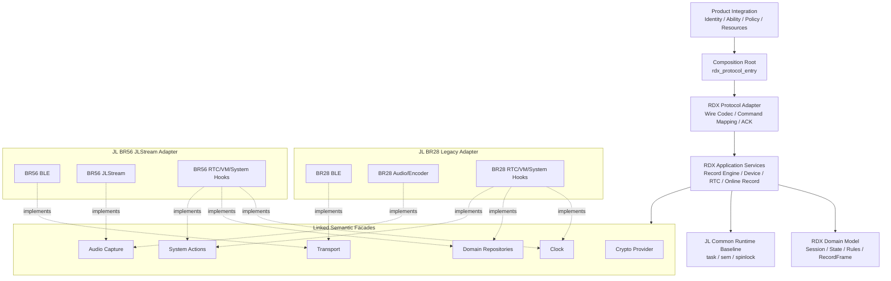

# RDX 同生态跨芯片跨 SDK 架构设计

> 状态：AC710N/BR56 E-3 代码、Host、构建与本轮实机回归已完成；跨芯片移植按需启动
>
> 日期：2026-08-26
>
> 适用对象：AC701N/BR28 参考工程与 AC710N/BR56 Type-C 工程
>
> 当前实施范围：只完成 AC710N/BR56 Type-C 工程；AC701N/BR28 第二实现、共享源码提取和双 SDK 矩阵不纳入当前计划。

## 1. 文档目的

本文定义 RDX 在同一 JL 生态内跨芯片、跨 SDK 代际复用时的目标架构。当前需要处理的不是 JL 与 STM32、ESP32 等异构平台之间的通用移植，而是：

- 参考工程使用 AC701N/BR28 及其旧版 SDK；
- 当前 Type-C 工程使用 AC710N/BR56 及新版 SDK；
- 两边的 BLE、任务、VM、RTC 等基础 API 存在相似部分；
- 两边的音频框架、产品生命周期和业务集成方式存在明显差异；
- RDX Wire 协议、鉴权、设备状态、会话和录音业务语义应尽量保持一致。

本文回答以下问题：

1. 哪些 RDX 代码应成为跨芯片共享核心；
2. 哪些差异必须留在各 SDK Adapter 中；
3. 是否需要 HAL、OSAL、vtable 或条件编译；
4. 产品 Ability、SDK 能力和运行时资源如何保持一致；
5. 当前工程如何渐进演进，而不重新引入参考工程的强耦合结构。

本文冻结目标边界和迁移原则，并记录 AC710N/BR56 当前平台的实施状态，不改变现有硬件行为。跨芯片设计保留为未来移植约束，但没有真实目标项目时不要求提前实现第二套 Adapter。

## 2. 与现有文档的关系

本文继承以下已有决策：

- [99.嵌入式跨平台设计模式.md](./99.嵌入式跨平台设计模式.md) 中关于 Wrapper、vtable、OSAL、构建选择和避免过度抽象的原则；
- [3-3.RDX录音基础设施架构优化方案.md](./3-3.RDX录音基础设施架构优化方案.md) 中 Record Engine、Destination、TX Scheduler、资源租约和状态所有权边界；
- [5-1.RDX新静态库全量业务移植前边界加强方案.md](./5-1.RDX新静态库全量业务移植前边界加强方案.md) 中“本地 RDX 协议与业务实现 + 静态库仅作为加密 Provider”的决策。

本文不改变以下约束：

- 不允许本地 RDX 与参考静态库业务双栈运行；
- 不因跨芯片抽象而新增静态库业务符号或 archive member；
- 不把参考工程的当前实现直接定义为 Golden Behavior；
- 不让 USB、音频、BLE 等 JL 公共模块反向依赖 RDX 业务；
- 不修改独立的 `t2616cc-firmware/` 参考工程来配合当前工程构建。

如果后续决定由供应方静态库重新接管完整协议或业务，必须另行进行架构切换评审，不能作为本文 Adapter 的一种实现渐进接入。

## 3. 结论先行

针对 AC701N/BR28 与 AC710N/BR56，复核后推荐采用：

> RDX 领域模型 + 应用服务 + 窄语义接口 + 构建期 SDK Adapter + 产品装配层

具体决策如下：

1. 不建设覆盖整个 JL SDK 的通用 HAL；
2. 不把参考工程的 `rdx_app.c`、`rdx_record.c` 或 `rdx_ble_server.c` 直接改造成公共核心；
3. 领域模型只表达状态、规则和不变量；Wire 编解码属于 Protocol Adapter，Record Engine 属于应用编排，不把两者误称为纯领域核心；
4. 当前由 BR56 SDK 实现窄语义端口；未来接入 BR28 或其他 JL SDK 时，目标 Adapter 必须实现同一组端口；
5. 每个固件在构建时只选择一套 SDK Adapter，不进行运行时芯片切换；
6. 单实现 Port 默认使用“同名接口 + 构建选源 + 链接期缺符号失败”，不为 BR28/BR56 切换引入运行时 vtable；
7. 只对真实运行时多态保留 vtable，例如 Record Destination，以及未来确实同时存在的 Source/Backend；
8. Product Ability、Compiled Capability、Boot Structural Capability 和 Operational Readiness 分层；
9. 参考工程只作为业务需求、Wire 兼容和异常场景的证据来源；可复用行为必须先转写为公共合同和测试；
10. 先在当前工程收敛边界；只有出现真实移植需求时，才实现第二套 Adapter，并根据第二实现的证据决定是否提取唯一来源的共享组件。

### 3.1 最佳实践复核结论

本场景只有两个已知 SDK 家族，而且芯片在构建时已经确定。最佳实践不是抽象层最多，而是让变化只能发生在少数文件，同时让漏实现尽早失败。

| 方案 | 复核结论 | 原因 |
| --- | --- | --- |
| 在业务代码中散布 BR28/BR56 `#ifdef` | 不采用 | SDK 差异会扩散，新增业务需要同时修改多处 |
| 建设完整 JL HAL/OSAL | 不采用 | 两套 SDK 同属 JL 生态，抽象范围远大于 RDX 真实需要 |
| 所有 Port 都放进运行时 vtable Manifest | 不作为默认方案 | 固件不会运行时切换 SDK，增加装配、NULL 检查和 ABI 管理成本 |
| 同名语义接口 + 构建选源 + 链接期绑定 | 默认采用 | 零运行时分派，缺少必需实现时链接失败，最符合当前规模 |
| Record Destination 等真实运行时策略使用小 vtable | 保留 | 同一固件内确有多实现、多实例或 fake 注入价值 |
| 直接复制一份共享代码到两个工程 | 不采用 | 修复和协议演进会形成永久分叉 |

因此，本文使用“Port”表示稳定语义边界，不等于必须用函数指针表实现。Port 的默认 C 实现是普通函数声明，由构建系统选择唯一实现文件。

### 3.2 可移植性承诺边界

目标架构成立后，可以把新 JL 芯片的主要移植工作收敛到 SDK Adapter 和 Product Integration，但不能承诺“只要函数名对上就无条件运行”。准确表述是：

> 只要目标芯片满足目标 RDX Ability 所需的结构能力、资源预算和时序语义，并且对应 SDK Adapter 通过合同验证，就可以复用同一套 Domain Model、Application Service 和 Protocol Adapter。

不同目标的接入成本分为：

| 目标情况 | 接入方式 | 预期工作量 |
| --- | --- | --- |
| 芯片属于已有 SDK/API 家族，能力和语义一致 | 复用现有 Adapter，新增 Product Integration 和配置 | 低 |
| 芯片属于新 SDK/API 家族，但能力完整 | 新增一套 Adapter，公共业务不分叉 | 中 |
| 缺少某个可选业务能力 | 关闭对应 Ability，不编造空实现 | 取决于剩余业务 |
| 缺少 RDX 基础必需能力或资源预算 | 不能启用 RDX，或必须先改变产品需求 | 不可直接移植 |

“满足 Port”至少包含五类合同：

1. **接口合同**：类型、错误分类、幂等和生命周期入口完整；
2. **语义合同**：例如 Notify 返回值只代表传输接纳，callback generation 和 buffer 所有权一致；
3. **结构能力合同**：BLE、Audio、Clock、Repository、Crypto 及工具生成资源真实存在；
4. **非功能合同**：RAM、Flash、任务栈、实时吞吐、队列容量和启动/退出 deadline 满足目标业务；
5. **共存合同**：USB Audio、BLE、RTC、VM、Power 和录音资源仲裁在目标产品上成立。

因此，“任何 JL 芯片都能轻松移植”应理解为架构把变化集中并使工作量可预测，而不是免除每颗芯片的 Adapter 实现、能力审查和目标硬件验证。

### 3.3 E-2 后再次复核结论

E-2 完成后再次对照 99 号文档、当前源码、构建接入和九组 Host 测试复核，结论是：总体架构与多态选择正确，不需要回退或建设更重的 HAL/OSAL；剩余问题属于当前平台的小范围边界收口，而不是新的跨芯片阶段。

已确认成立：

- 普通函数 Port、构建期选源和链接期绑定符合“目标芯片在构建时已确定”的约束；
- Domain、Application、Protocol、SDK Adapter、Product Integration 和 Provider 已形成可审查的物理边界；
- 芯片宏、JLStream、VM ID 和 Type-C 策略没有泄漏到共享头文件；
- Record Destination 是当前唯一需要运行时多态的业务边界，不需要把所有 Port 改造成 vtable；
- 当前平台的 Host、构建和实机证据足以支持稳定维护，但不能替代第二真实 Adapter 对跨芯片合同的反证。

仍需在当前平台收口：

1. 代码中只有 `RDX_CFG_IMPLEMENTED_ABILITY` 形式的 Ability 同位掩码，Compiled Capability、Boot Structural Capability 和 Operational Readiness 尚未形成可执行的独立检查链；
2. Audio `probe` 同时被用于结构能力和瞬时源就绪判断，通话场景会把 USB 音频流是否活跃混入永久 Capability；
3. Device State Domain 仍通过 `rdx_wire_defs.h` 获取名称和 Mic Gain 边界，依赖方向应改为 Wire 使用 Domain 约束；
4. 多个共享 `.c` 仍通过 `system/includes.h` 间接获得标准库和基础类型。JL Common Runtime 使用者可以保留精确的 Runtime 头文件，但不应继续依赖聚合头文件；
5. 6 号文档顶部状态和部分“现状”描述需要明确区分重构前基线与已完成现状。

上述事项进入阶段 E-3。E-3 不创建 BR28 Adapter，不改变 Wire、VM、音频格式、任务模型、业务状态或产品 Ability，也不建立跨工程共享包。

## 4. 现状对比与问题定位

### 4.1 参考工程

参考工程位于：

    t2616cc-firmware/SDK/apps/common/third_party_profile/rdx_protocol/

其主要特征是：

- `rdx_app.c` 同时包含 App、BLE、TWS、Audio、ANC、Power、GPIO、VM、Battery 等大量 JL 头文件；
- `rdx_record.c` 同时拥有录音状态、定时器、任务、Mic Gain、BLE 发送判断及旧音频编码路径；
- `rdx_ble_server.c` 同时处理 GATT、连接状态、协议协作、VM、录音和电源策略；
- `rdx_vm.c` 除持久化外还依赖 BLE、TWS、Record、RTC 和协议状态；
- 业务模块通过全局状态、`extern`、定时器和 SDK 对象相互访问。

这种结构能够在单一产品内工作，但不能通过少量 `#ifdef CONFIG_CPU_BR28/BR56` 安全变成公共模块。若直接跨芯片复用，会出现以下问题：

- SDK 差异扩散到所有业务文件；
- 同一状态出现多个所有者；
- 参考工程中的产品策略被误带入 Type-C 产品；
- 编译通过不能证明资源、回调上下文和错误语义一致；
- 后续任一产品修复都会形成双份甚至多份分叉。

### 4.2 E-2 前的 AC710N/BR56 工程基线

本节保留开始重构时的问题基线，用于解释 A～E-2 各阶段为何存在；当前完成状态以第 13 节的实施结果为准。

当前工程已经完成部分正确分层：

- `rdx_mvp0_protocol.c` 承担 Wire 解析和命令处理，并只通过窄 Port 使用外部能力；
- `rdx_protocol_session.c` 以纯 C 维护连接 generation、CCC 与鉴权就绪策略；
- `rdx_record_engine.c` 承担录音会话和采集生命周期，并通过 Audio Capture Port 使用采集能力；
- `rdx_record_audio_br56.c`、`rdx_record_call_audio_br56.c` 承担 JLStream 适配；
- `rdx_ble_transport_br56.c` 承担 GATT/ATT 适配；
- `rdx_device_state.c` 通过 Device State Repository 使用持久化能力；
- `rdx_record_destination_ops` 已表达输出目的地的真实业务可插拔性；
- `rdx_integration_config.h` 已把 Ability、源码门控和资源依赖关联起来。

但当前仍存在以下跨 SDK 阻碍：

- BR28 Transport、Audio Capture 和 Device State Repository 尚无第二真实实现，当前公共合同仍只经过 BR56 与 host fake 验证；
- 部分尚未迁移的公共头文件仍通过 `system/includes.h` 获得 `u8/u16/u32` 等类型；
- RTC Service 同时实现时间业务策略、硬件 RTC 和 VM 读写；
- `RDX_CFG_IMPLEMENTED_ABILITY` 目前表达的是单一目标工程能力，尚未区分产品声明与 SDK Adapter 能力。

因此，当前工程适合作为共享核心的演进起点，但不能简单将文件名中的 `_br56` 删除后宣称跨芯片完成。

### 4.3 差异强度判断

| 领域 | BR28 与 BR56 差异 | 推荐处理 |
| --- | --- | --- |
| Wire 协议、鉴权、命令状态 | 原则上低 | 分别进入 Protocol、Application 和 Domain |
| Record Session、状态、错误 | 原则上低 | 进入共享 Domain/Application |
| BLE GATT/ATT API | 中等，接口相似但事件和发送语义需核对 | Transport Adapter |
| VM/syscfg 基础 API | 表面相似，ID、对象布局和校验策略不同 | Domain Repository Adapter |
| RTC | API 相似，初始化、信任和备份策略需拆分 | Clock Adapter + RTC Service |
| 任务、信号量、Timer | 中等，名称和生命周期接口存在差异 | 最小 Runtime Adapter |
| 音频采集和编码 | 高，旧编码路径与 JLStream 模型不同 | 完整 Audio Capture Adapter |
| TWS、Battery、Charge、LED、Key、Power | 高度产品相关 | Product Integration，不进入共享 Domain/Application |
| 资源文件和音频流程 | 高度工具与产品相关 | 产品资源 + Adapter 运行时探测 |

## 5. 统一术语

### 5.1 RDX Domain Model

RDX Domain Model 是不依赖芯片、SDK、Wire 格式和产品模式的状态、规则与不变量集合，包括：

- 鉴权状态及授权规则；
- Record Session、Session Controller 和 Capture Generation；
- RecordFrame、有效时间轴、状态转换和错误分类；
- Device State 中与持久化方式无关的约束。

Domain Model 应尽量是确定性的普通 C 逻辑：输入命令或事件，输出状态迁移、领域事件或拒绝原因。它不创建 JL Task，不访问 Port，不编解码 Wire，不访问 VM，也不操作 BLE 或 JLStream 对象。

### 5.2 RDX Application Service

RDX Application Service 是业务用例和资源生命周期的协调者，例如 Record Engine、Online Record Service、RTC Service 和 Device Management Service。它调用 Domain Model，并通过 Port 使用 BLE、Audio、Clock 和 Repository。由于本文范围限定在 JL 生态，Application Service 可以使用经过双 SDK 审计的 JL Common Runtime Baseline，但不得直接调用随芯片或 SDK 代际变化的 API。

Record Engine 当前同时包含状态规则、队列、worker 和 Audio 调用，目标上属于 Application Service。只有从中提取出的纯 Session 状态迁移规则才属于 Domain Model。

### 5.3 RDX Protocol Adapter

RDX Protocol Adapter 负责 V23/MVP0 Wire 编解码、命令到用例的映射和领域结果到 ACK 的映射。它是 RDX 的入站/出站协议边界，不拥有录音会话、RTC 信任或设备状态规则。

### 5.4 Port / Semantic Facade

Port 是 Application Service 对外部能力提出的稳定语义合同。Port 描述“RDX 需要什么”，不复刻 JL SDK 函数表，也不意味着必须使用 vtable。

默认实现方式是普通 C 函数，例如 `rdx_audio_capture_open()`；BR28、BR56 和 host fake 分别提供同名实现，由构建系统只选择一套。

### 5.5 SDK Adapter

SDK Adapter 是某一 JL SDK/API 家族对 Port 的实现。Adapter 可以包含 JL 头文件、芯片宏、资源 UUID、VM ID 和 SDK 对象。

Adapter 应按 SDK/API 家族命名，例如：

- `jl_br28_legacy`；
- `jl_br56_jlstream`。

如果多个芯片可以共享同一 SDK Adapter，应复用该 Adapter，而不是按产品复制代码。

### 5.6 Product Integration

Product Integration 是具体产品对身份、Ability、按键、电源、资源、授权策略和模式的装配。`T2616CC` 与 `Type_c_AC7106F6` 的产品策略不得进入共享 Adapter。

### 5.7 Capability 与 Readiness

Capability 表示 Adapter 或运行目标实际能够提供的技术能力。Capability 不等同于产品对 APP 广播的 Ability。

Readiness 表示当前连接、当前资源租约或当前系统状态是否允许立即执行操作。临时不 Ready 不表示产品永久失去 Ability。

## 6. 目标架构

### 6.1 总体关系



图中 BR28 和 BR56 两套 Adapter 是设计全集；任一固件的最终构建只能选择其中一套。

### 6.2 依赖规则

允许：

    Product Integration -> Composition Root
    Composition Root -> Protocol Adapter / Application Service
    Protocol Adapter -> Application Service
    Application Service -> Domain Model / Port
    Application Service -> 已审计 JL Common Runtime Baseline
    SDK Adapter -> Port 合同 / JL SDK

禁止：

    Domain Model -> Port / JL SDK / Wire
    Domain Model -> Product Integration
    Protocol Adapter -> *_br28 / *_br56
    Application Service -> *_br28 / *_br56
    BR28 Adapter -> BR56 Adapter
    JL BLE/Audio/USB -> RDX Service
    Product A Integration -> Product B Integration

公共 Domain、Application、Protocol 和 Port 头文件不得包含：

- `system/includes.h`；
- `app_config.h`；
- JL BLE、RTC、Audio 或 Power 头文件；
- `struct jlstream` 等 SDK 对象；
- `CFG_*`、`VM_*` 等产品持久化 ID；
- 芯片或板级 GPIO、UUID、Node ID。

公共类型优先使用 `stdint.h`、`stddef.h`、`stdbool.h` 中的标准类型。

## 7. 语义接口设计

### 7.1 总体原则

每个语义接口必须满足：

1. 以 RDX 业务语义命名，不以 JL API 命名；
2. 输入输出中不出现 SDK 对象；
3. 接口数量来自当前两个实现的真实交集，不为未来假想平台预留万能函数；
4. 明确同步或异步、调用上下文和阻塞上限；
5. 明确 buffer 是借用、复制还是转移所有权；
6. 明确重复调用、退出和异常路径是否幂等；
7. 明确错误是可重试、致命、不支持还是当前未就绪；
8. 所有延迟回调携带并校验 generation；
9. 必须能力缺失时通过编译、链接或初始化失败，不使用 weak 空实现静默退化。

### 7.2 Transport Facade

Transport Facade 负责：

- 注册和注销 RDX GATT Transport；
- 向 Protocol Adapter/Application Service 投递连接、断链、CCC 和 RX 事件；
- 提交 Notify；
- 请求发送就绪通知；
- 返回当前连接 generation 和链路状态；
- 执行受控断链。

推荐标准发送结果：

```c
enum rdx_transport_result {
    RDX_TRANSPORT_ACCEPTED = 0,
    RDX_TRANSPORT_RETRYABLE,
    RDX_TRANSPORT_FATAL,
    RDX_TRANSPORT_UNAVAILABLE,
};
```

其中 `ACCEPTED` 只表示本地 ATT 队列已经接纳，不表示空口成功或 APP 已收到。Transport Adapter 可以知道 ATT handle、CCC、DLE、PHY 和 `app_ble_*`；Protocol Adapter 和 Application Service 不得根据 JL event code 实现业务判断。

### 7.3 Audio Capture Facade

Audio Capture Facade 负责：

- 根据 `format_id` 和 `scene` 探测结构能力；
- 事务式打开采集路径；
- 启动前安装帧回调；
- 验证最终采样率、声道、编码、帧长和 payload；
- 暂停、恢复或关闭采集周期；
- 在源丢失、格式错误和资源抢占时投递标准事件；
- 幂等释放 SDK 资源。

公共接口只接收 `RDX_RECORD_FORMAT_MEETING_V1` 等格式 ID，不允许 Application Service 自由拼装 JL 节点参数。BR28 可以使用旧录音/Opus 路径，BR56 可以使用 JLStream；两者只需满足相同的候选帧和生命周期合同，不需要伪造相同的内部 Pipeline。

Mic Gain 的查询、持久化和产品范围不应自动并入 Audio Capture。采集启动所需的 gain 可以作为 open 参数；面向 APP 的 Mic Gain 业务使用独立的 Mic Settings Facade，避免 Capture 接口随设备设置业务膨胀。

### 7.4 Clock Facade 与 RTC Service

必须区分：

- 单调时间：用于 timeout、active PTS 和耗时，不受 UTC 校时影响；
- 墙上时间：用于真实日期、时间戳和 APP 设置 RTC。

Clock Facade 只负责读取单调时间、读取硬件墙上时间，以及设置并回读验证硬件墙上时间。

合法年份、placeholder、trusted 状态、备份恢复时机和对外错误映射属于共享 RTC Service。因此现有 `rdx_rtc.c` 应拆成 RTC Service、Clock Adapter 和 RTC Backup Repository，而不是为 BR28/BR56 各复制一份完整 RTC 业务。

### 7.5 Domain Repository

不推荐向 Application Service 暴露通用 `syscfg_read(id, ...)`，也不推荐建立不断增长的万能 `rdx_store_object` 枚举。优先定义与领域对象一致的窄 Repository：

```c
int rdx_device_state_repository_load(struct rdx_device_state_data *out);
int rdx_device_state_repository_save(
    const struct rdx_device_state_data *state);

int rdx_rtc_backup_repository_load(uint32_t *timestamp);
int rdx_rtc_backup_repository_save(uint32_t timestamp);
```

各 Repository Adapter 负责 VM ID、持久化布局版本、长度校验、默认值、read-back 和掉电语义。底层可以共享少量 JL VM helper，但共享 Domain/Application 不知道 `CFG_*` 或 `VM_*`。

### 7.6 JL Common Runtime Baseline

当前代码审计表明，AC701N/BR28 与 AC710N/BR56 SDK 都提供：

- `task_create/task_kill`；
- `os_sem_create/os_sem_pend/os_sem_post`；
- `spin_lock_init/spin_lock/spin_unlock`。

因此现阶段把这组经过验证的原语作为 JL Common Runtime Baseline，比建立第二套 OSAL 或 per-chip Runtime vtable 更合适。参考工程选择 `os_task_create`、当前 Engine 选择 `task_create`，属于调用方式差异；旧 SDK 同样提供 `task_create`，不能据此推导出必须抽象整个任务系统。

Baseline 的约束是：

- 只允许 Application `.c` 使用，Domain Model 和公共数据合同不包含 JL OS 类型；
- 只纳入两个 SDK 已证明签名和语义一致的最小集合；
- 每增加一个 JL SDK 家族都必须重新核对；
- 若未来 SDK 偏离基线，或 host Application 测试确实需要替换执行器，再增加 `rdx_executor_start/wake/stop` 等局部同名 Wrapper；
- 不得把 mutex、queue、task 的全部原生参数复制成第二套 OSAL。

### 7.7 System Action Facade

只为 RDX 真实用例定义具名动作，例如获取自动关机策略、请求恢复出厂、请求关机或投递产品事件。不要建立可以承载任意产品操作的 `rdx_platform_ioctl()` 或巨型 Product Control 表。

Battery、Charge、LED、TWS、Key 和 Power 的完整业务仍归 Product Integration 所有。

### 7.8 Crypto Provider

Crypto Provider 继续保持独立、窄且可审计：

- `rdx_appkey_verifier.c` 是唯一调用者；
- 静态库只提供已批准的解密符号；
- 协议、RTC、录音和设备管理不得直接依赖静态库；
- 更换芯片或 SDK 不得扩大 archive member 白名单。

## 8. 装配与多态选择

### 8.1 默认：构建期选择、链接期绑定

对于每个固件只有一个实现的能力，Port 头文件声明普通函数：

```c
int rdx_transport_notify(const uint8_t *data, uint16_t len);
int rdx_audio_capture_open(
    const struct rdx_audio_capture_request *request);
int rdx_clock_wall_set(uint32_t timestamp);
```

BR28 Adapter、BR56 Adapter 和 host fake 分别提供同名符号。构建系统必须只选择一套实现：

```text
AC701N/BR28:
    Domain/Application/Protocol
    + jl_br28_legacy
    + t2616cc integration

AC710N/BR56:
    Domain/Application/Protocol
    + jl_br56_jlstream
    + type_c_ac7106f6 integration

Host contract tests:
    Domain/Application/Protocol
    + host_fake
```

这种方式具有零运行时分派、缺实现时链接失败、调用路径直观等优点，也能通过替换链接实现完成 fake 测试。

### 8.2 何时使用 vtable

只在以下条件之一成立时使用小型 vtable：

- 同一固件运行时同时存在多种实现；
- 同一接口需要多个实例和不同私有上下文；
- 实现需要在运行时注册、挂接或摘除；
- 测试必须在同一进程内切换多个实现，且链接替换无法满足。

现有 `rdx_record_destination_ops` 符合这些条件，应继续保留。BR28 与 BR56 的 SDK 选择不符合这些条件，不应为其建立全局 Port vtable。

### 8.3 接口版本

当前 Domain、Application 和 Adapter 一起从源码编译，不需要 `struct_size + abi_version` 的运行时 ABI 协商。接口不匹配应通过头文件、编译器和链接器暴露。

只有未来将共享 Domain/Application 与 Adapter 作为独立二进制、由不同团队异步发布时，才引入显式 ABI version、size 和兼容策略。不能为尚不存在的二进制插件场景提前承担复杂度。

### 8.4 条件编译边界

Domain Model、Application Service 和 Protocol Adapter 内不得散布：

```c
#if defined(CONFIG_CPU_BR28)
...
#elif defined(CONFIG_CPU_BR56)
...
#endif
```

少量条件编译只允许出现在同一 Adapter 家族内部，用于几行签名或常量差异。若分支改变完整资源生命周期、事件顺序或错误语义，应拆成独立 Adapter 文件。

### 8.5 共享源码提取时机

不得让当前工程通过相对路径直接编译 `t2616cc-firmware/` 中的源文件，也不要在 Port 尚未由第二个实现验证前就把当前代码发布成通用组件。

推荐顺序是：

1. 先在当前 AC710N 工程建立边界；
2. 用 BR28 Adapter 验证接口是否真是两边的稳定交集；
3. 删除只服务于单一实现的伪通用接口；
4. 再把已验证的 Domain/Application/Protocol 提取为唯一来源组件；
5. 两个产品以明确版本引入，不复制后独立修改。

## 9. Ability 与 Capability 模型

### 9.1 四层模型

必须区分：

1. `RDX_PRODUCT_ABILITY`：产品准备对 APP 公布的业务能力；
2. `RDX_PORT_COMPILED_CAPS`：当前 SDK Adapter 编译实现的技术能力；
3. `RDX_BOOT_STRUCTURAL_CAPS`：启动探测确认硬件、工具资源和持久化结构实际存在的稳定能力；
4. Operational Readiness：当前连接、CCC、链路参数、资源租约和系统状态是否允许立即执行某项命令。

必须满足：

```text
required_caps(RDX_PRODUCT_ABILITY)
    subset of
    (RDX_PORT_COMPILED_CAPS intersect RDX_BOOT_STRUCTURAL_CAPS)
```

Ability 与 Capability 不要求共用同一位定义。`required_caps()` 负责把业务 Ability 映射成所需结构能力，例如在线录音需要 Audio Capture、Opus、足够的本地 ATT 缓冲上限、控制器 DLE 支持和发送就绪事件。

Operational Readiness 不参与永久 Ability 的计算。例如 BLE 暂未连接、CCC 未打开、当前连接未协商到目标参数或 USB 正占用音频资源，只表示当前 START 需要拒绝、等待或按策略抢占，不能动态改写设备 Ability。

### 9.2 编译期检查

编译期可以验证：

- 当前产品选择了唯一 Adapter；
- 产品 Ability 不超过 Adapter 声明能力；
- 必需接口声明、配置宏和唯一 Adapter 源选择存在；
- 格式参数和固定容量位于合法范围；
- 对应源码和静态库只在 RDX ON 时进入构建。

### 9.3 启动结构探测

运行时必须验证编译宏不能证明的事项：

- JLStream 或旧音频资源真实存在；
- 节点、Encoder 和最终格式匹配；
- Controller 和本地 ATT 配置具备业务所需上限；
- RTC 读写和回读有效；
- VM 对象尺寸和版本有效；
- 回调注册、资源租约和 worker 创建成功。

产品声明的必需结构能力探测失败时，RDX 启动必须 fail-closed，不得通过替代 Pipeline、默认格式或旧业务入口继续运行后仍对外广播对应 Ability。对于可以明确降级且不会形成虚假 Ability 的非必需诊断能力，可以禁用该能力并记录原因。

### 9.4 Operational Readiness

每次执行在线录音等用例时，再检查瞬时条件：

- 当前 connection generation 是否有效；
- 鉴权、CCC 和命令门控是否成立；
- 当前 ATT Payload、DLE/PHY/连接参数是否满足该路径；
- Audio Resource Lease 是否可取得；
- TX 队列和关键 ACK 槽是否可用；
- 当前系统是否正在关机、解绑或恢复出厂。

Readiness 失败必须返回稳定、可审计的业务结果，不得伪装成 Capability 缺失，也不得永久清除 Ability。

### 9.5 Ability 所有权

Ability 仍由产品配置唯一声明。Adapter 只能声明技术 Capability，不能自行打开产品 Ability；静态库包含某项业务也不能自动提高 Ability。

## 10. 事件、线程与数据生命周期

### 10.1 单一状态所有者

跨 SDK 后仍保持：

- Protocol Adapter 拥有 Wire request/ACK 映射，不拥有业务状态；
- Auth Application Service 拥有当前鉴权会话，Domain Model 定义授权规则；
- Record Session Model 定义合法迁移，Record Engine Application Service 拥有当前 Session、Capture Generation 和资源编排；
- Transport Adapter 拥有 JL BLE handle、CCC 和本地发送状态；
- Audio Adapter 拥有 Pipeline、Encoder 和采集 callback；
- Repository Adapter 拥有 VM ID、持久化布局和底层读写；
- Product Integration 拥有产品电源、按键、LED、TWS 和模式策略。

Adapter 不得通过读取 Domain/Application 全局变量获得业务所有权。

### 10.2 入站事件

所有 SDK callback 必须转换为规范事件后进入 RDX：

```text
JL BLE RX callback
    -> TRANSPORT_RX(connection_generation, payload)

JL BLE disconnect
    -> TRANSPORT_LINK_LOST(connection_generation, cause)

JL Audio callback
    -> AUDIO_FRAME(session_id, capture_generation, borrowed_payload)

USB/Power callback
    -> trusted SYSTEM_EVENT(source, generation, cause)
```

Domain Model、Application Service 和 Protocol Adapter 不得根据 JL event code 或 callback 函数地址判断事件类型。

### 10.3 回调合同

每个 Adapter callback 必须说明：

- 运行于 ISR、协议任务、系统任务还是 Adapter worker；
- 能否阻塞；
- payload 的有效期；
- 是否允许重入；
- shutdown 后是否仍可能到达；
- generation 如何阻止旧回调污染新对象。

旧 generation 的延迟帧、Timer、can-send 事件和 disconnect completion 必须被拒绝或只记诊断，不得改变新 Session。

### 10.4 初始化和退出

推荐初始化顺序：

```text
构建已选择唯一 SDK Adapter
    -> 初始化 Repository / Clock Adapter
    -> 执行 Boot Structural Capability 探测
    -> 验证 Product Ability 所需结构能力
    -> 初始化 Application worker / Services
    -> 注册 Transport 和外部 callback
    -> 开放协议命令入口
```

推荐退出顺序：

```text
关闭新命令入口
    -> 投递可信 SHUTDOWN
    -> 有界等待 Service / Engine 到安全状态
    -> 取消发送、Timer 和音频采集
    -> 注销外部 callback
    -> 销毁 Application worker
    -> 释放 Adapter 资源
```

所有 init、stop 和 exit 必须幂等。退出超时不得释放仍可能被 callback 引用的对象，也不得把平台强制终止描述成 RDX 已安全退出。

## 11. 目录结构与命名规则

阶段 A～E 允许先通过接口边界完成逻辑分层，但当前 AC710N/BR56 在阶段 E-2 结束前必须完成物理目录收口。物理目录不是装饰：它必须让 SDK Adapter、产品策略和供应方静态库无法继续与共享业务文件混放，并让代码评审能够从路径直接判断允许的依赖方向。

```text
rdx_protocol/
  include/
    rdx/
      rdx_runtime.h
      rdx_wire_defs.h
      rdx_ability.h
      rdx_capability.h
      rdx_factory_identity.h
      rdx_record_types.h
      domain/
        rdx_device_state_model.h
        rdx_record_session.h
      ports/
        rdx_transport_port.h
        rdx_audio_capture_port.h
        rdx_clock_port.h
        rdx_device_identity_port.h
        rdx_factory_identity_port.h
        rdx_mic_settings_port.h
        rdx_product_profile_port.h
        rdx_device_state_repository_port.h
        rdx_rtc_backup_repository_port.h
        rdx_system_action_port.h

  domain/
    rdx_record_session.c

  application/
    rdx_ble_name_service.c
    rdx_device_management_service.c
    rdx_device_state_service.c
    rdx_factory_identity.c
    rdx_identity_service.c
    rdx_mic_gain_service.c
    rdx_record_engine.c
    rdx_rtc_service.c
    rdx_session_metadata_service.c

  protocol/
    v23/
      rdx_protocol_v23.c
      rdx_protocol_v23_management.c
      rdx_protocol_v23_record.c
      rdx_protocol_v23_internal.h
      rdx_protocol_session.c

  adapters/
    jl_br56/
      rdx_transport_jl_br56.c
      rdx_audio_capture_jl_br56.c
      rdx_clock_jl_br56.c
      rdx_device_identity_jl_br56.c
      rdx_factory_identity_jl_br56.c
      rdx_device_state_repository_jl_br56.c
      rdx_rtc_backup_repository_jl_br56.c
      rdx_mic_settings_jl_br56.c
      audio/
        rdx_meeting_capture_jlstream.c
        rdx_call_capture_jlstream.c

  integration/
    type_c_ac7106f6/
      rdx_runtime.c
      rdx_product_compat_profile.h
      rdx_product_profile_type_c.c
      rdx_product_key_routing.c
      rdx_system_action_type_c.c

  providers/
    appkey/
      rdx_appkey_verifier.c
      librdxApp.a

  tests/
    ...
```

目录和命名必须满足以下规则：

1. `include/rdx/` 只放跨层合同和对外入口；仅供单个实现使用的私有头文件与实现文件同目录；
2. Port 头文件统一使用 `_port.h`，表达“RDX 需要的能力”；实现函数仍保持简洁的 `rdx_transport_*`、`rdx_clock_*` 等业务语义；
3. SDK Adapter 按真实 SDK/API 家族归档并使用 `_jl_br56` 等后缀，不能只用含混的 `_br56`，也不能用产品名替代 SDK 家族；`JLStream` 只标记真实依赖该音频框架的采集实现，不扩散到 BLE、Clock 或 Repository；
4. Product Integration 按产品命名。Type-C PC 模式按键、自动关机和兼容身份属于 `type_c_ac7106f6`，不得因使用 BR56 API 就误称为 BR56 通用 Adapter；
5. `rdx_` 前缀继续作为 C 全局命名空间保留；目录分层不能替代符号前缀；
6. `MVP0` 是早期交付里程碑，不是当前正式模块名。当前线上兼容协议使用 V23，因此内部文件、符号、日志、错误信息和测试名统一使用 `V23` 或稳定业务术语；
7. 已发布的 `RDX_MVP0_PING` / `RDX_MVP0_PONG` 是 Wire 诊断字面量，在没有 APP/工具兼容性证据前保持不变。保留 Wire 字面量不等于继续保留 MVP0 内部架构命名；
8. 当前仍沿用 701 产品身份和固定电量的事实必须保留为显式 Product Compatibility Profile，不能仅通过改名伪装成量产配置；AuthKey/Label SN 不再由 Product Profile 提供，未烧录认证码时由 Identity Service 运行时生成全零身份，Wi-Fi MAC 仍保留全零兼容字段；真实产品身份和 Battery Provider 冻结后再移除对应兼容项；
9. 当前已审计的 task/sem/spinlock 继续形成 JL Common Runtime Baseline，不建立独立 Runtime Port。未来只有新 SDK 偏离基线时才新增局部 Wrapper；
10. 如果 BLE 或 VM 实现经过双平台编译和事件测试后被证明完全相同，可以下沉到未来的 `adapters/jl_common/`；不得仅因函数名相同就提前声明公共实现。

产品身份配置和芯片身份来源必须进一步区分：

- Product Profile Port 只读提供本产品的默认 BLE 名、兼容身份字段、Device Ability、V23 版本字段、兼容电量、广播间隔、软硬件版本和 AppKey 白名单；共享 Application、Protocol 与 SDK Transport Adapter 不得直接包含 `rdx_product_compat_profile.h`；
- 默认 BLE 名称的拼接规则也属于 Product Integration：共享 BLE Name Service 只调用 `rdx_product_profile_build_default_ble_name()`，不得直接读取 AuthKey 的固定偏移或复制产品后缀策略；
- `rdx_product_compat_profile.h` 是当前 Type-C 产品的私有编译期配置，只允许由 `rdx_product_profile_type_c.c` 和 `rdx_integration_config.h` 使用；后者仅用于从 Ability 派生源码选择和执行编译期结构校验；
- Device Identity Port 只表达“读取 6 字节 BLE MAC”这一最小硬件能力；`le_controller_get_mac` 和相关 JL BLE 头文件只能出现在 `rdx_device_identity_jl_br56.c`；
- Identity Service 负责将 Product Profile 与 Device Identity 组合成 RDX Identity 和 Manufacturer Data，不拥有 JL API，也不拥有 Type-C 配置宏；
- Product Profile 属于 Product Integration，不得放入 `adapters/jl_br56`；Device Identity 属于 SDK Adapter，不得混入具体产品配置。这样迁移到同一 JL 生态的新芯片时，两类变化可分别替换，不会因复用 BLE Transport 而继承错误的产品身份。

## 12. 当前文件的目标归属

| 当前文件 | 目标归属 | 主要调整 |
| --- | --- | --- |
| `rdx_mvp0_protocol.c` / `.h` | `protocol/v23/rdx_protocol_v23.*` | 删除内部 MVP0 里程碑命名；入口只保留生命周期、Transport 事件路由和 V23 命令分派 |
| `rdx_protocol_session.c` / `.h` | `protocol/v23/rdx_protocol_session.*` | 以纯 C 维护连接 generation、CCC 和鉴权就绪不变量，隔离旧连接事件 |
| `rdx_mvp0_protocol.c` 中的管理命令 | `protocol/v23/rdx_protocol_v23_management.c` | 只保留管理类 Wire 解析、ACK 编码和 post-ACK 动作，不拥有 Repository 或产品动作实现 |
| `rdx_mvp0_protocol.c` 中的录音发送逻辑 | `protocol/v23/rdx_protocol_v23_record.c` | 只保留 V23 录音 Wire、Destination 和发送队列，不拥有 Audio Capture 生命周期 |
| `rdx_record_engine.c` | `application/rdx_record_engine.c` | 保留 worker、队列、Destination 编排和 Port 调用；把纯 Session 转移规则提取到 `domain/rdx_record_session.*` |
| `rdx_audio_capture.h` | `include/rdx/ports/rdx_audio_capture_port.h` | 以标准整数、scene、format ID、标准结果和借用帧 callback 冻结公共合同 |
| `rdx_audio_capture_br56.c` | `adapters/jl_br56/rdx_audio_capture_jl_br56.c` | 实现普通同名 Port，并在 Adapter 内选择会议或通话采集子实现 |
| `rdx_record_audio_br56.c` | `adapters/jl_br56/audio/rdx_meeting_capture_jlstream.c` | 保留会议录音 JLStream、ADC 配置和 Opus 参数细节，删除含混的 `record_audio` 命名 |
| `rdx_record_call_audio_br56.c` | `adapters/jl_br56/audio/rdx_call_capture_jlstream.c` | 保留通话采集 JLStream/CVP 细节 |
| `rdx_transport.h` / `rdx_ble_transport_br56.c` | Transport Port / `adapters/jl_br56/rdx_transport_jl_br56.c` | Port 使用 `_port.h`；Adapter 保留 GATT/ATT 细节并输出标准事件和发送结果 |
| `rdx_clock.h` / `rdx_clock_br56.c` | Clock Port / `adapters/jl_br56/rdx_clock_jl_br56.c` | Port 不包含 SDK 日历；Adapter 负责 BR56 日历转换和写后回读 |
| `rdx_identity.c` 中的 BLE MAC 读取 | Device Identity Port / `adapters/jl_br56/rdx_device_identity_jl_br56.c` | Service 只组合身份；Adapter 唯一包含 JL BLE API 并读取 6 字节 BLE MAC |
| 量产认证码读取与解析 | Factory Identity Port / `application/rdx_factory_identity.c` / `adapters/jl_br56/rdx_factory_identity_jl_br56.c` | Provider 隔离 Flash 布局、长度和 CRC；纯解析器校验 AuthKey、BLE MAC、Label SN；Identity Service 消费已验证记录，或在 Provider 明确返回 `NOT_PRESENT` 时生成全零开发身份 |
| `rdx_mic_settings.h` / `rdx_mic_settings_br56.c` | Mic Settings Port / `adapters/jl_br56/rdx_mic_settings_jl_br56.c` | 独立承接工厂 Mic Gain 查询，不把设备设置业务并入 Audio Capture |
| `rdx_rtc.c` | `application/rdx_rtc_service.c` | 文件名明确表达 Application Service；硬件 RTC 和 VM 继续只经 Port 访问 |
| `rdx_device_state_data.h` / `rdx_device_state.c` | `domain/rdx_device_state_model.h` / `application/rdx_device_state_service.c` | 维护绑定、名称和 Mic Gain 的业务状态与事务式更新，不知道 VM ID 和持久化版本 |
| `rdx_device_state_repository.h` / `rdx_device_state_repository_br56.c` | Repository Port / `adapters/jl_br56/rdx_device_state_repository_jl_br56.c` | 隔离 VM ID、v1/v2/v3 布局、迁移、净化、长度与回读校验 |
| `rdx_rtc_backup_repository.h` / `rdx_rtc_backup_repository_br56.c` | Repository Port / `adapters/jl_br56/rdx_rtc_backup_repository_jl_br56.c` | 隔离 RTC 备份 VM ID、4 字节布局、同值跳写和回读校验 |
| `rdx_system_actions.h` / `rdx_system_actions_type_c.c` | System Action Port / `integration/type_c_ac7106f6/rdx_system_action_type_c.c` | 以具名能力提供 Type-C 自动关机策略，不建立通用 Platform 操作入口 |
| `rdx_key_adapter_br56.c` | `integration/type_c_ac7106f6/rdx_product_key_routing.c` | 该文件拥有 PC 模式和产品按键映射，属于 Product Integration 而不是 BR56 通用 Adapter |
| `rdx_protocol_entry.c` / `.h` | `integration/type_c_ac7106f6/rdx_runtime.c` / `include/rdx/rdx_runtime.h` | 对外使用 `rdx_runtime_start/stop`，集中编排选中的实现、结构探测和失败回滚 |
| `rdx_mvp0_compat_config.h` | `integration/type_c_ac7106f6/rdx_product_compat_profile.h`、`rdx_product_profile_type_c.c` 与 Product Profile Port | 私有配置保留真实兼容债务；运行时只读值经 Port 提供，删除共享层对产品宏的直接依赖 |
| `rdx_protocol_defs.h` / `rdx_record_defs.h` | `rdx_wire_defs.h`、`rdx_ability.h` / `rdx_record_types.h` | 避免含混的 `defs`，按 Wire、Ability 和录音公共类型拆分 |
| `rdx_integration_config.h` | Product Integration | 拆分 Product Ability、Compiled Capability 和结构能力校验 |
| `rdx_appkey_verifier.c` / `librdxApp.a` | `providers/appkey/` | 保持供应方静态库唯一调用边界；供应方 archive 名称原样保留 |

参考工程中的旧模块不直接进入上述共享目录。每项需要迁移的业务必须先确定：

1. 对应 Domain、Application 或 Protocol 职责是否已经存在；
2. 旧行为是正式合同、产品策略还是偶然实现；
3. 当前 APP 是否仍依赖该行为；
4. 需要新增哪个 Port 能力；
5. 两套 Adapter 是否都能实现并验证；
6. Ability、异常路径和资源所有权是否一致。

## 13. 分阶段实施

### 当前实施范围与完成口径

本文区分两个不同里程碑：

- **当前平台完成**：AC710N/BR56 的 RDX 业务边界完成收敛，公共语义有 host/fake 测试，当前 SDK 能完成编译、链接和固件打包，并通过 AC710N 实机业务回归；这是当前唯一实施目标。
- **跨芯片移植完成**：某个新 JL 芯片拥有真实产品需求，其 Adapter、Product Integration、构建矩阵和目标硬件验证全部成立；该里程碑按需启动，不作为当前平台完成的前置条件或遗留缺陷。

因此，以下 B～E 阶段中涉及 BR28 第二实现的内容保留为未来移植清单，不再计入当前计划的验收范围。当前计划在阶段 E-3 代码、Host、构建完成并完成本轮 AC710N/BR56 实机回归后结束；原阶段 F 已改为按需启动的未来移植清单，不在当前平台连续执行。

### 阶段 A：冻结公共合同

目标：先确定跨芯片真正共享的语义，不移动大块代码。

- 冻结错误分类、事件、generation 和生命周期语义；
- 建立 Transport、Audio、Clock、Repository 的最小同名接口头文件；
- 使用标准整数类型定义公共源码接口；
- 建立 Product Ability、Compiled Capability、Boot Structural Capability 和 Operational Readiness 的区别；
- 为两个产品列出能力矩阵。

当前平台验收：公共头文件不包含 JL SDK 头文件，且评审能逐项说明每个接口的业务必要性、BR56 实现和 host/fake 证据。未来接入新目标时，再由第二真实实现复核接口是否仍为稳定交集。

### 阶段 B：先迁移 Transport 边界

目标：Protocol 不再直接依赖 `rdx_ble_transport_br56.h`。

- 让现有 BR56 Transport 实现新合同；
- 统一连接 generation、RX、CCC、link lost 和 can-send 事件；
- 统一 `ACCEPTED/RETRYABLE/FATAL/UNAVAILABLE`；
- 通过构建选择链接 host fake Transport，建立协议事件测试；
- 出现真实移植需求后，再根据合同实现目标 Transport Adapter。

验收：共享 Protocol 无 BR28/BR56 名称，fake 可覆盖连接、鉴权、CCC、断链和拥塞事件序列。

#### 阶段 A/B 首个实施切片（2026-08-26）

当前 AC710N/BR56 工程已完成 Transport 边界的第一轮落地：

- 新增仅依赖标准整数类型的 `rdx_transport.h`，冻结普通同名函数、发送结果和 Transport 事件合同；
- Protocol 和 Composition Root 不再包含 `rdx_ble_transport_br56.h`，旧的 BR56 专用公共头文件已移除；
- 发送、断链等出站操作改为普通 Port 函数和链接期绑定，不再通过 init 参数注入函数实现；
- BR56 Adapter 通过事件 callback 投递连接、断链、Identity Read、CCC、RX 和 can-send，Adapter 不再反向包含 Protocol 或 Record Engine；
- 所有事件携带 connection generation，Protocol 丢弃不属于当前连接的延迟事件；
- BR56 `ble_cmd_ret_e` 已在 Adapter 内映射为 `ACCEPTED/RETRYABLE/FATAL/UNAVAILABLE`；
- MTU、PHY、DLE 和 SDK 原始返回码等诊断细节保留在 BR56 Adapter 内，没有进入公共合同；
- AC710N 工程已执行 clean 后全量编译、链接和固件打包。

该切片提交后，用户已完成 AC710N 实机业务回归，确认现有业务行为不受影响。该结论不替代后续针对 BLE 拥塞、异常断链等边界序列的专项验证。

#### 阶段 A/B 第二个实施切片（2026-08-26）

在第一轮 Transport 解耦基础上，继续完成可脱离 JL SDK 验证的会话合同：

- 新增仅依赖标准 C 类型和 `rdx_transport.h` 的 `rdx_protocol_session.c/.h`；
- 由该组件唯一维护当前 connection generation、连接、Identity Read、CCC 和鉴权就绪状态；
- 非当前 generation 的 CCC、断链和 can-send 等延迟事件统一在纯 C 边界丢弃；
- CCC 关闭、当前链路断开或新连接建立时，鉴权状态按合同失效；
- `rdx_mvp0_protocol.c` 复用该状态机并只执行 Wire、录音停止、定时器等协议副作用，不再自行复制 generation 过滤规则；
- 新增可复用的 host fake Transport，使用与 BR56 Adapter 相同的普通同名 Port 符号，通过 callback 驱动真实会话组件和真实 MVP0 Protocol；
- Transport 合同测试覆盖连接、Identity Read、CCC、RX 借用数据、鉴权、`RETRYABLE -> can-send -> ACCEPTED`、重连以及旧 generation 事件隔离；
- MVP0 host 测试直接链接真实 `rdx_mvp0_protocol.c`，关闭与本切片无关的录音/RTC 能力，覆盖 PING、CCC 门控、AppKey 鉴权、鉴权失效、旧连接 RX 和鉴权 ACK 拥塞断链；两组测试均已通过。

当前平台的阶段 B 已完成：AC710N/BR56 Transport 边界、会话 generation 和 host 合同均已落地并通过实机回归。AC701N/BR28 Transport Adapter 转入按需移植清单；未来实现时仍需用第二真实实现反证并收敛合同，但它不再是当前平台的验收缺口。

### 阶段 C：迁移 Audio Capture 边界

目标：Record Engine Application Service 不再直接依赖 BR56 Audio Adapter。

- 以格式 ID、scene 和标准帧 callback 定义合同；
- BR56 JLStream 代码留在 BR56 Adapter；
- 出现真实移植需求后，根据目标产品业务实现对应 Audio Adapter；
- 不要求两个 SDK 具有相同内部 Pipeline；
- 对帧格式、warmup、Pause/Resume、source lost 和关闭超时建立一致测试。

当前平台验收：Engine 只看到 Audio Facade、RecordFrame 和标准事件，AC710N/BR56 通过构建和目标硬件录音验证。未来目标必须独立完成同一合同和硬件验证。

#### 阶段 C 首个实施切片（2026-08-26）

按“优先验证当前 AC710N/BR56 平台”的范围，本切片先完成公共 Audio Capture 边界和 BR56 真实实现接线：

- 新增不包含 JL SDK 头文件的 `rdx_audio_capture.h`，公共参数只暴露 scene、format ID、标准整数、generation、借用帧 callback 和故障 callback；
- 冻结 `OK/BUSY/SOURCE_UNAVAILABLE/UNSUPPORTED/FAILED` 五类结果，由 BR56 Adapter 统一吸收 `-EBUSY/-ENODEV/-EINVAL` 等 SDK/实现错误；
- `rdx_record_defs.h` 改用标准整数类型，不再通过公共录音定义向上层传播 `system/includes.h` 和 `BIT()`；
- `rdx_record_engine.c` 只调用普通同名 Audio Capture Port，不再包含或调用 `rdx_record_audio_br56`、`rdx_record_call_audio_br56`；
- 新增 `rdx_audio_capture_br56.c`，会议/通话 scene 的选择留在 BR56 Adapter 家族内部，原有两条 JLStream Pipeline 的参数、启停、Pause/Resume 和帧回调时序保持不变；
- 现有 `audio_capture_lease` 不含芯片或 JLStream 类型，且同时服务 USB UAC 与 RDX 的资源仲裁，继续作为当前共享 Application Policy/JL Common Runtime 组件，而不是伪装成 BR56 Audio API；
- 工厂 Mic Gain 查询没有并入 Audio Capture；新增独立 `rdx_mic_settings.h` 和 BR56 实现，Mic Gain Service 不再直接包含 BR56 Audio 头文件；
- 新增可复用 host fake Audio Capture，合同测试覆盖 scene/format 门控、事务式打开、重复打开、借用帧 token、故障事件、Pause/Resume generation 更新和幂等关闭；Audio、Transport 和真实 MVP0 Protocol 三组 host 测试均已通过；
- AC710N/BR56 已执行 `clean + all`，新 Port、BR56 实现和 Mic Settings 实现均进入真实目标编译、链接与固件打包；设备在线时已完成固件下载。

当前平台的阶段 C 已完成：AC710N/BR56 Audio Capture 边界、BR56 真实实现、host 合同和实机录音回归均已成立。不能用该结论反推 BR28 Audio Adapter 已成立；BR28 音频实现和双平台硬件证据转入按需移植清单，不影响当前平台完成。

### 阶段 D：拆分 RTC、VM 和 System Action

目标：共享业务规则不再包含 `syscfg_*`、RTC 结构和产品电源 API。

- 拆分 RTC Service、Clock Adapter 与 RTC Backup Repository；
- 拆分 Device State 与 Device State Repository；
- 把自动关机、关机和恢复出厂放入 Product Integration；
- 明确持久化对象版本和跨固件升级策略。

验收：共享 Service 能通过 fake Clock/Repository 验证首次启动、非法时间、写失败、回读失败和恢复场景。

#### 阶段 D 首个实施切片（2026-08-26）

按“优先验证当前 AC710N/BR56 平台”和“小步拆分职责”的范围，本切片先完成 Device State Repository 与现有 System Action 的收敛：

- 新增只依赖标准整数和领域常量的 `rdx_device_state_data.h`，内存中的领域状态不再携带 VM 版本、保留字节或 JL SDK 类型；
- 新增普通同名函数合同 `rdx_device_state_repository.h`；`rdx_device_state.c` 不再包含 `user_cfg_id.h`，也不再调用 `syscfg_read/syscfg_write` 或记录 `CFG_*`；
- Device State Service 只维护绑定、BLE 名称覆盖和 Mic Gain 覆盖规则；更新先构造下一状态，Repository 保存成功后才提交内存状态，写失败不会造成“内存已生效、掉电后回退”的分裂状态；
- 新增 BR56 Repository Adapter，唯一拥有 `CFG_RDX_DEVICE_STATE`、v1/v2/v3 持久化布局、旧版本迁移、损坏字段净化、当前 v3 编码、写长度检查和写后回读校验；现有 32 字节 v3 VM 布局保持兼容；
- `LOAD_CURRENT/LOAD_RECOVERED` 明确区分“当前规范对象”与“空、旧版本或已净化对象”。后者继续使用安全默认值或可恢复字段，并在下一次显式恢复默认/业务保存时修复，保持既有首次启动与升级行为；
- 删除只包含单个函数的 `rdx_platform_br56.c/.h`；自动关机查询改为 `rdx_system_actions.h` 中的具名能力，并由 `rdx_system_actions_type_c.c` 实现产品策略。Protocol 因此不再包含任何 BR56 Platform 头文件；
- 新增 fake Device State Repository 和真实 Service 测试，覆盖首次启动、恢复写入、重复写跳过、持久化失败时内存回滚、合法更新和非法输入；
- 新增 BR56 Repository Adapter host 测试，覆盖 v1 迁移、空 VM、安全净化、v3 写入与当前版本读取、底层写失败和回读不一致；真实 MVP0 Protocol 测试增加自动关机命令及 Wire 响应覆盖；
- Device State、BR56 Repository、Audio Capture、Transport 和真实 MVP0 Protocol 五组 host 测试均通过；AC710N/BR56 已执行 `clean + all`，新边界进入真实目标编译、链接、固件及 OTA 打包，并在设备在线时完成固件下载。

#### 阶段 D 第二个实施切片（2026-08-26）

本切片继续按“普通同名函数 + 构建选源 + 链接期绑定”拆分当前 RTC，并保持现有 AC710N/BR56 时间与 VM 行为：

- 新增只使用标准整数的 `rdx_clock.h`；Clock Port 返回时间戳及默认占位标记，写操作只表达硬件是否接纳，写后回读和可信状态仍由 RTC Service 决策；
- 新增 `rdx_clock_br56.c`，唯一包含 `rtc/rtc_dev.h`、`struct sys_time`、`def_sys_time`、JL 日历转换函数和硬件 RTC 读写；SDK 返回值、日历合法性、32 位时间戳可表示性和转换回环检查在 Adapter 内收敛；
- 新增只使用标准整数的 `rdx_rtc_backup_repository.h` 与 BR56 实现；Repository 唯一拥有 `CFG_RDX_RTC_BACKUP`、`syscfg_read/syscfg_write`、同值跳写、写长度检查和写后回读校验，既有 4 字节原始时间戳布局保持兼容；
- `rdx_rtc.c` 现在只保留合法年份、placeholder 是否可信、trusted 状态、硬件优先/备份恢复、硬件写后回读、硬件成功后再保存备份以及对外 `0/-1` 映射，不再包含 RTC 结构、VM ID 或 `syscfg_*`；
- 保持既有异常语义：首次启动的默认占位时间不可信；合法硬件时间优先且不读取备份；备份只恢复合法时间；硬件写入或回读失败时不保存 VM；硬件已验证但 VM 保存失败时返回失败并保留硬件可信状态，允许后续关机备份重试；未可信或临时读钟失败时跳过备份；
- 新增 fake Clock/Repository 的真实 RTC Service 测试，覆盖硬件启动、placeholder 恢复、非法硬件/备份时间、硬件写失败、硬件回读失败与不一致、VM 保存失败、可信状态保持和备份读失败；
- 新增 BR56 Clock Adapter 与 RTC Backup Repository host 测试，覆盖 SDK 日历归一化、placeholder、非法/不可表示日历、硬件返回错误、空 VM、同值跳写、VM 写失败、回读失败、回读不一致及 4 字节布局；新增三组与既有五组 host 回归均通过；
- AC710N/BR56 已执行 `clean + all`，RTC Service、BR56 Clock 和 BR56 Backup Repository 均进入真实目标编译和链接，固件与 OTA 打包成功；随后已完成固件下载和实机回归，RDX 连接、录音及 RTC 相关业务未发现异常。

当前平台的阶段 D 已完成：AC710N/BR56 Clock、RTC Backup Repository、Device State Repository 和具名 System Action 已完成边界收敛、host 验证及实机回归。BR28 对应实现转入按需移植清单；恢复出厂若在未来产品出现额外整机动作，再由该产品的 Product Integration 补充，不为未知需求预留万能接口。

### 阶段 E：维护 JL Common Runtime Baseline

每接入一个新 JL SDK 家族时执行：

- 复核 task、sem、spinlock 的声明、timeout 单位、callback 上下文和退出行为；
- 保持单 worker 事件串行模型；
- 只有发现真实差异时才抽取 worker 启停、wake 和有界等待 Wrapper；
- 不建立覆盖整个 JL OS 的 OSAL；
- 对 shutdown 后延迟 callback 和 timer generation 做故障注入。

当前平台验收：AC710N/BR56 满足幂等 init/exit、有界退出和旧事件隔离。未来目标接入时必须重新审计并满足同一合同。

#### 阶段 E 首个实施切片（2026-08-26）

本切片继续优先收敛当前 AC710N/BR56，同时以只读方式复核 AC701N/BR28 参考 SDK 的 Common Runtime 声明和单位，不新增 OSAL 或 Runtime vtable：

- 对照两套 SDK 的 `task.h`、`os_api.h`、`os_type.h`、`spinlock.h`、`timer.h` 和 `jiffies.h`：`task_create/task_kill`、`os_taskq_post_msg/os_taskq_pend`、`os_sem_create/os_sem_pend/os_sem_post/os_sem_set` 及 `spin_lock_init/spin_lock/spin_unlock` 的声明一致；两边均为每秒 100 个 OS tick，`msecs_to_jiffies` 均按 10 ms 换算；`sys_timeout_add` 均接收毫秒，并把一次性 callback 投递回注册 timeout 的任务上下文。BR56 SDK 额外提供的任务查询函数不属于 RDX 最小集合，不构成 Runtime Port 的理由；
- `rdx_record_engine_shutdown` 的公共参数由含混的 tick 改为明确的毫秒，Composition Root 使用 1000 ms，换算后仍是原有 100 tick 等待，保持当前退出时长；零超时不再被 JL API 解释为无限等待，非整 tick 的合法等待会向上取整；
- Record Engine 新增“worker 已创建”生命周期标记，wake 依据 worker 是否存在，而不是依据 worker 函数是否已开始运行，关闭了 `task_create` 已成功但 `task_running` 尚未置位时立即 shutdown 漏唤醒的窗口；仍维持单 worker、控制请求/系统事件/录音帧串行处理模型，没有抽取第二套 Executor；
- MVP0 Protocol 增加幂等 init/exit 的 active gate；退出先关闭 Transport 事件入口，尚未注销或延迟到达的连接、CCC、RX 和 can-send callback 不再重建 Session 或执行命令；若 Record Engine 有界退出失败，Composition Root 仍保留 Transport 和相关对象供后续重试，不把超时描述成安全退出；
- post-ACK disconnect timeout 使用跨 init/exit 单调递增的 generation，并通过 timeout `priv` 带回原 token；取消时先失效 pending/action/generation，再删除 JL timeout。旧 callback 即使在协议重启且新 timeout 已建立后到达，也只能记录 stale 诊断，不能清除新动作或断开新连接；
- MVP0 host 测试加入生命周期故障注入，覆盖重复 init 不破坏已认证 Session、exit 后延迟 Transport 事件被拒绝、取消后的旧 timer callback 与新 timer 并存时被 generation 隔离，以及当前 timer 仍能执行预期断链；本切片与既有 RTC、Repository、Audio 和 Transport 共八组 host 测试均通过。
- AC710N/BR56 已执行 `clean + all`；修改后的 Protocol、Record Engine 和 Composition Root 均进入真实目标编译及链接，固件与 OTA 打包成功，构建脚本检测到设备在线并完成固件下载；随后完成实机业务回归，RDX 连接和录音业务未发现异常。

当前平台的阶段 E 已完成代码、host、构建和 AC710N/BR56 实机业务回归。Common Runtime 的源码声明和单位已在两套 SDK 中完成只读复核，因此无需为已证明相同的 API 建 Wrapper。AC701N/BR28 的真实 callback 调度、任务退出和硬件共存证据转入按需移植清单，不作为当前验收项。

### 阶段 E-2：当前平台目录、命名与迁移痕迹收口

阶段 A～E 证明了当前边界的行为，但扁平目录、含混文件名和 MVP0 里程碑名称仍会把临时移植结构固化为长期公共接口。E-2 只处理 AC710N/BR56，不创建 BR28 Adapter，不改变 Wire、VM、录音格式或产品行为。

#### E-2.1 物理分层与稳定命名

- 按第 11 节建立 `include/rdx`、`domain`、`application`、`protocol/v23`、`adapters/jl_br56`、`integration/type_c_ac7106f6` 和 `providers/appkey`；
- Port 头文件统一使用 `_port.h`，BR56 实现统一使用 `_jl_br56.c`；`JLStream` 只保留在真实依赖该框架的音频实现名中；
- Composition Root 对外改用 `rdx_runtime_start/stop`，Type-C 按键和自动关机策略进入 Product Integration；
- Product Profile 和 Device Identity 分别经最小 Port 进入共享代码；共享 Application、Protocol 和 Transport Adapter 不直接包含 Type-C 兼容配置，Identity Service 不直接包含 JL BLE API；
- 只修改 `SDK/build/genFileList.c` 和受影响的源码选择；`SDK/build/fileList.mk` 继续作为生成文件，不手工维护；
- 本切片只允许路径、文件名、包含路径和等价符号调整，不允许顺便改变状态、timeout、VM、Wire 或音频参数。

#### E-2.2 删除内部 MVP0 阶段命名

- 当前协议实现按已冻结的 `0x17` 兼容配置命名为 V23 Protocol；源码路径、类型、函数、日志、错误信息和 Host 测试名不再使用 MVP0；
- `rdx_mvp0_compat_config.h` 改为 Type-C Product Compatibility Profile，固定电量等宏改用兼容配置语义；
- `RDX_MVP0_PING`、`RDX_MVP0_PONG` 仅作为已发布 Wire 字面量保留，内部常量名使用诊断语义；
- 历史 MVP0 文档继续保留，不批量改写历史结论；当前 6 号架构文档只使用稳定术语描述现状；
- 701 身份、Wi-Fi 全零兼容字段和固定电量在真实产品数据冻结前继续显式标记为兼容债务，不能通过删除注释或普通改名隐藏；AuthKey/Label SN 的旧占位字段已移除，未烧录认证码的全零回退必须保持为运行时降级语义。

#### E-2.3 过大实现文件拆分

- V23 Protocol 入口只拥有生命周期、Transport 事件路由和命令分派；管理命令/post-ACK 调度与录音 Wire/Destination 分别进入独立实现文件；共享状态通过私有 Context 和内部接口传递，不新增公共全局变量；
- Record Engine 保留单 worker、请求队列、系统事件和采集编排；可在不访问 JL API、Port、队列或锁的前提下独立判断的录音 Session 状态迁移进入 Domain；
- 拆分前后的 public API、Wire 字节、VM 布局、callback 所有权、generation、timeout 单位、任务栈和音频参数保持不变；
- 不以 `.inc` 文本包含伪装 C 模块拆分，也不为跨文件共享状态暴露新的公共头文件。

#### 阶段 E-2 验收口径

1. `rdx_protocol/` 根目录不再平铺业务 `.c/.h`，路径能直接识别职责；
2. 当前源码、构建生成器和测试中不存在作为内部架构名称的 `mvp0/MVP0`；允许项只有明确列入白名单的 Wire 字面量及历史文档；
3. 共享 Domain/Application/Protocol/Port 头文件不包含 BR56/JLStream/VM ID/产品按键和 Type-C 策略；共享实现不直接包含 Type-C Product Compatibility Profile，Identity Service 不直接包含 JL BLE API；
4. 九组 Host 测试继续通过，并覆盖 Record Session、V23 Protocol 生命周期、Transport、Audio、Clock、Repository、RTC 和 Device State 合同；
5. AC710N/BR56 执行 `clean + all`，链接、固件和 OTA 打包通过；生成文件不进入提交；
6. 实机回归继续验证 RDX 连接、认证、设备管理、RTC、会议/通话录音、暂停恢复、录音标记以及 USB Audio 共存；编译和 Host 测试不能替代该硬件结论。

#### 阶段 E-2 当前平台实施结果（2026-08-26）

当前 AC710N/BR56 已完成 E-2 的代码、Host、构建和实机回归：

- RDX 源码已物理收口到 `include/rdx`、`domain`、`application`、`protocol/v23`、`adapters/jl_br56`、`integration/type_c_ac7106f6`、`providers/appkey` 和 `tests`；`rdx_protocol/` 根目录不再平铺业务源码；
- Port 统一使用 `_port.h`，SDK 家族实现统一使用 `_jl_br56.c`，只有真实依赖 JLStream 的会议/通话采集文件保留 `jlstream`；Composition Root 已改为 `rdx_runtime_start/stop`；
- Product Profile Port 已隔离 Type-C 默认名称、兼容身份、Ability、版本、固定兼容电量、广播间隔和 AppKey 白名单；Device Identity Port 已隔离 `le_controller_get_mac`。共享 Application、V23 Protocol 和 Transport Adapter 不再直接包含 Type-C Compatibility Profile，Identity Service 不再直接包含 JL BLE API；
- 内部 MVP0 文件、符号和测试名已替换为 V23 或稳定业务术语；源码中仅保留兼容所必需的 `RDX_MVP0_PING/PONG` Wire 字面量；701 身份、Wi-Fi 全零兼容字段和固定电量仍以 Product Compatibility Profile 显式记录，没有伪装成量产配置；AuthKey/Label SN 的旧占位宏已移除，未烧录认证码时的全零回退由 Identity Service 明确实现；
- V23 Protocol 已拆为入口、管理命令、录音 Wire 和私有 Context；Record Engine 的纯 Session 状态迁移已进入 Domain，worker、队列、Port 调用和采集编排仍留在 Application；
- 公共 RDX 头文件已使用标准整数类型，不再包含 `system/includes.h`；九组 Host 测试全部通过；
- AC710N/BR56 已执行 `clean + all`，完整录音分支编译、链接、固件和 OTA 打包通过，生成 `jl_isd.bin`、`jl_isd.fw` 与 `update.ufw`；构建脚本检测到设备在线并完成下载；
- 烧录后已完成实机回归：RDX 连接、重连、AppKey 认证、设备管理、RTC、会议录音、通话录音、Pause/Resume、录音标记和 USB Audio 共存均正常；录音统计未出现发送失败、丢帧或队列溢出，业务行为未受影响。

阶段 E-2 和“当前平台完成”里程碑至此关闭。BR28 或其他 JL 芯片的 Adapter、双 SDK 构建矩阵和目标硬件验证仍按未来真实移植需求启动，不属于本阶段遗留缺陷。

### 阶段 E-3：当前平台最佳实践收口

E-3 来源于 E-2 完成后的再次复核，只优化当前 AC710N/BR56 的依赖方向、Capability 语义和可验证性。它不是跨芯片阶段，也不以增加抽象层数量为目标。

#### E-3.1 Domain 约束不依赖 Wire

- Device State Model 自己定义 BLE 名称长度和 Mic Gain 领域边界，include guard 与 `model` 文件名一致；
- Application Service 和 Repository 使用 Domain 约束；
- `rdx_wire_defs.h` 可以把已发布 Wire 边界映射到相同的 Domain 常量，但 Domain 不得反向包含 Wire；
- 不改变 BLE 名称最大长度、Mic Gain 数值范围、VM 布局或 Wire 校验结果。

#### E-3.2 Capability 与 Readiness 可执行化

- 新增独立于 Device Ability 位定义的技术 Capability；当前至少表达 Transport、Device State Repository、Factory Identity、Device Identity、RTC、Meeting Capture 和 Call Capture；量产认证码是当前产品的必需结构能力；
- Product Ability 通过显式映射得到 Required Capability，不能再直接拿 Ability 位掩码冒充 Adapter Capability；
- `RDX_PORT_COMPILED_CAPS` 表达当前构建实际链接的技术能力，缺少 Required Capability 时编译失败；Factory Identity Provider 与解析器均被纳入 BR56 可用能力声明；
- Composition Root 在开放 Transport 入口前累计 `RDX_BOOT_STRUCTURAL_CAPS`，并验证 Required Capability；任一永久结构能力缺失时启动 fail-closed；
- Audio Structure Probe 只检查格式、工具资源、Pipeline 和 Provider 结构是否存在；Audio Readiness Probe 才检查当前 USB 音频源、资源租约等瞬时条件；
- Meeting/Call 当前未就绪不得清除产品 Ability，启动结构校验也不得要求 USB 通话流已经活跃。

#### E-3.3 缩窄共享源码 include

- Domain 与普通 Application/Protocol 实现使用标准 C 头文件和 RDX 合同，不再为 `memcpy`、`snprintf`、`uint*_t` 或日志依赖 `system/includes.h`；
- Record Engine 只允许包含经双 SDK 审计的 task、sem、jiffies 和 spinlock 精确头文件；
- V23 post-ACK 调度只允许包含精确 Timer 头文件；
- `app_config.h` 暂时保留为当前 JL 构建的 Feature Gate 入口，未来提取唯一共享源码时再决定是否形成独立生成配置；
- 不为消除聚合头文件而建立第二套 OSAL。

#### 阶段 E-3 验收口径

1. Domain 头文件不包含 Wire、JL SDK 或产品配置，现有 Wire/VM 边界值不变；
2. Device Ability、Required Capability、Compiled Capability、Boot Structural Capability 和 Operational Readiness 在代码中分别可识别；
3. 启动结构检查失败时不注册 Transport、不广播虚假 Ability，已初始化资源按逆序回滚；
4. 通话录音源未活跃只导致命令时 Readiness 失败，不导致 RDX 启动失败或永久 Ability 改写；
5. 共享 Application/Protocol 不再包含 `system/includes.h`；允许的 JL Runtime 依赖必须使用精确头文件且保持已审计最小集合；
6. 九组 Host 测试继续通过，并增加 Factory Identity Provider/Service、BLE 名称服务、Audio Structure/Readiness 与 Capability 映射覆盖；
7. AC710N/BR56 执行 `clean + all`，固件及 OTA 打包通过；随后由实机回归确认 RDX、录音和 USB Audio 行为不变。

#### 阶段 E-3 当前平台实施结果（2026-08-26）

E-3 的当前平台代码收口、Host 验证和构建验证已完成：

- Device State Domain 已脱离 `rdx_wire_defs.h`，Wire 层仅映射已发布边界；共享 Application、Protocol 和 Domain 继续保持精确 include；
- Product Ability、Required Capability、Compiled Capability、Boot Structural Capability 和 Operational Readiness 已在源码中分层，BR56 Capability 声明与编译期检查生效；启动期结构能力检查缺失时保持 fail-closed；
- 量产认证码已形成独立 Factory Identity Port、BR56 Provider 和纯 C 解析器；未编程保留区通过明确的 `NOT_PRESENT` 结果回退为全零身份，已存在认证码的 CRC/长度/字段校验失败仍保持 fail-closed；启动成功后同时记录 Factory Identity 与 Device Identity 结构能力；
- Audio Capture 已拆分结构能力检查与瞬时 Readiness 检查，通话/会议音频源暂未就绪不会被误判为永久 Ability 缺失；
- RDX ON 已执行 `clean + all`，完整录音分支编译、链接、固件和 OTA 打包通过，构建脚本检测到 BR56 设备在线并完成下载；
- RDX OFF 已完成独立构建与 OTA 打包，确认关闭第三方协议后产品仍可完整编译；随后恢复 RDX ON 配置；
- Host 测试脚本九组全部通过，覆盖 Factory Identity Parser/Provider/Service、BLE 名称服务、Record Session、V23 Protocol 生命周期、Audio Capture Structure/Readiness、RTC Service 和 Device State Service；BR56 Clock、RTC Backup Repository、Device State Repository 等 SDK 细节由目标构建和实机回归验证，不再单独维护重复 Host 测试；
- 已完成静态边界检查：共享 Application/Protocol 无 `system/includes.h`，Domain 无 Wire/JL SDK/产品配置依赖，源码中保留的 `MVP0` 仅为兼容 Wire 字面量及其测试输入。

本轮 E-3 代码变更已下载到目标设备，并已完成串口/实机业务回归。RDX 连接、认证、录音、Pause/Resume、录音标记及 USB Audio 共存均通过验证，未发现业务行为回归；该结论仅适用于 AC710N/BR56 当前产品，不替代未来目标芯片的独立硬件验证。

#### E-3 之后的架构复核结论（2026-08-27）

对照 99 号文档、当前源码、Host 测试和 BR56 构建再次复核（本轮认证码架构收口未重新进行实机烧录），当前方案仍符合本项目的最佳实践，结论如下：

- `domain`、`application`、`protocol/v23`、`adapters/jl_br56`、`integration/type_c_ac7106f6` 和 `providers` 的物理边界与依赖方向成立；共享层没有继续扩散芯片宏、JLStream、VM ID 或 BR56 私有对象；
- 当前芯片在构建期已经确定，因此普通同名 Port 函数、构建选源和链接期缺符号失败比全局 vtable 更合适；Record Destination 等真实运行时多态继续保留小 vtable；
- Product Ability、Required Capability、Compiled Capability、Boot Structural Capability 和 Operational Readiness 的职责区分成立，音频结构检查与瞬时源就绪检查没有混为一谈；
- 认证码读取/解析已作为独立 Factory Identity Capability 纳入启动必需能力；未烧录时的零身份是 Identity Service 的显式开发期降级，不是产品配置占位值；BLE 默认名称的 AuthKey 后缀策略位于 Type-C Product Integration Port，名称服务仅负责生命周期、校验和覆盖值优先级；
- 99 号文档是跨平台模式的通用选择指南，6 号文档是 JL 同生态 RDX 的场景化裁剪，两者不存在“必须建设完整 OSAL”或“必须为 BR28/BR56 运行时分派”的冲突；
- 当前仍未完成 BR28 第二套 Adapter、双 SDK 构建矩阵和跨工程唯一源码协作验证，因此只能宣称 AC710N/BR56 当前平台完成，不能宣称跨芯片移植已经完成。

本次复核不新增代码重构阶段。后续只有真实 JL 芯片移植需求出现时，才按未来移植清单实现第二套 Adapter，并用第二实现反证现有 Port 合同是否需要收窄或调整。

### 未来移植清单（当前不实施）

当前计划在阶段 E-3 和本轮 AC710N/BR56 实机回归完成后结束，不创建 BR28 Adapter、不提取跨工程共享包，也不建立双 SDK 持续构建矩阵。只有同时满足以下条件时才启动新的移植计划：

1. 已确认需要接入的 JL 芯片、SDK 版本和产品工程；
2. 已确认该产品要启用的 RDX Ability 及硬件资源预算；
3. 已取得可编译、可烧录和可实机验证的目标工程；
4. 已确定共享源码的仓库归属和版本协作方式。

启动后再执行：

- 先由目标芯片 Adapter 反证并精简公共接口；
- 确定共享 Domain/Application/Protocol 的唯一仓库和版本方式；
- 两产品禁止复制后私自修改公共文件；
- 建立双 SDK 编译矩阵；
- Port 源码接口或语义变化必须同时更新合同、fake 和两个 Adapter；
- 硬件行为仍分别由各产品实机验证。

## 14. 验证策略

### 14.1 Host/Fake 验证

适合脱离硬件验证：

- Wire 编解码和长度边界；
- 鉴权前后命令白名单；
- 重复命令幂等；
- Session、Pause/Resume、generation 和旧事件隔离；
- Transport retry/fatal 序列；
- Clock 非法值、回拨和 Store 失败；
- 初始化中途失败后的逆序回滚；
- Factory Identity Provider 的非法长度、CRC 错误，以及 AuthKey、BLE MAC、Label SN 记录解析；
- Factory Identity 未编程保留区的 `NOT_PRESENT` 到全零身份回退；
- Product Integration 默认 BLE 名称的认证码后缀、用户覆盖优先级和恢复默认；
- 有界 shutdown 和超时 fail-closed。

Host 测试是开发期验证工具，不进入固件源清单，也不是设备运行时依赖。当前只保留 9 组必要合同测试：Factory Identity Parser/Provider/Service、BLE 名称、Record Session、RTC Service、Device State Service、Audio Capture 和 V23 Protocol（其中包含 Transport Session、鉴权、拥塞和旧事件隔离）。BR56 Clock、RTC Backup Repository、Device State Repository 的 SDK 细节不再重复维护独立 Host 测试，改由目标构建、串口日志和实机异常矩阵验证。

```powershell
# Host 核心回归
powershell -NoProfile -ExecutionPolicy Bypass -File `
  SDK/apps/common/third_party_profile/rdx_protocol/tests/run_host_tests.ps1
```

Host 回归必须配合 AC710N/BR56 构建和目标硬件日志，不能替代 BLE、录音、RTC 掉电、VM 升级和 USB Audio 共存的实机验证。删除的是与目标适配器重复的测试文件，不是生产能力或运行时校验。

### 14.2 构建验证

当前平台维护期间，每次 Domain、Application、Protocol 或 Port 变更至少要求：

- AC710N/BR56 Adapter 编译；
- 变更涉及构建选择或能力门控时执行 RDX OFF 构建和 Ability 子集检查；
- Map 中静态库 member 白名单检查；
- Domain 和公共头文件无 JL SDK include 静态检查；共享 Application/Protocol 不包含 `system/includes.h`，经审计的 JL Common Runtime 只允许通过精确头文件进入指定实现。

未来移植计划被真实需求启动后，再增加目标 SDK Adapter 编译，并建立当前平台与目标平台的双 SDK 构建矩阵。

### 14.3 目标硬件验证

编译通过不能证明以下行为：

- BLE 连接、MTU、DLE、PHY 和吞吐；
- 在线录音丢帧与背压；
- Pipeline/Encoder 真实格式；
- RTC 掉电保持；
- VM 写入和升级兼容；
- USB Audio 与 RDX 资源抢占；
- 关机、断链、复位和恢复出厂清理。

当前实施只要求在 AC710N/BR56 目标硬件上验证并保留串口证据。未来接入新 JL 芯片时，新目标必须独立完成 BLE、Audio、RTC、VM、退出时序和资源共存验证，不能复用当前平台的硬件结论。

## 15. 反模式与停止条件

### 15.1 芯片宏扩散

如果 Domain、Application 或 Protocol 中开始出现多个 `CONFIG_CPU_BR28/BR56`，说明 Port 边界失效，应停止新增分支并重新审查接口。

### 15.2 巨型 Platform 层

不得把 BLE、Audio、RTC、VM、Power、Key、LED 全部装入一个 `rdx_platform.c`。这种文件只是把参考工程的 `rdx_app.c` 换了名字。

### 15.3 为旧实现设计抽象

Port 不能只是把参考工程每个全局函数换成函数指针。只有被共享业务真实需要、具有稳定语义的能力才能进入 Port。

### 15.4 静默可选实现

必须的 Transport、Store、Clock 或 Audio 操作不得依赖 weak 空函数或未检查的 `NULL`。缺失能力必须在编译期或初始化时失败。

### 15.5 抽象泄漏

如果 Port 参数中出现 ATT handle、JLStream UUID、VM ID、GPIO、Task 名称或 SDK 私有结构体，应停止并把该细节移回 Adapter。

### 15.6 双份共享源码

如果 BR28 和 BR56 工程各有一份名字相同但独立修改的 Domain/Application/Protocol，应停止宣称其为共享模块。必须建立唯一来源和版本关系。

### 15.7 参考行为未经确认直接迁入

参考工程中的三秒 Timer、重连恢复、全局 busy、默认格式、自动关机或重试次数等实现，不得未经 APP 行为、产品需求和故障场景确认就写入共享 Domain/Application。

## 16. 最终决策摘要

1. AC701N/BR28 与 AC710N/BR56 属于 JL 同生态跨 SDK 问题，不需要全平台 HAL；
2. 采用 Domain Model、Application Service、Protocol Adapter、Semantic Facade、SDK Adapter 和 Product Integration 的明确依赖方向；
3. 当前 AC710N 工程的 Protocol、Record Engine 和 Destination 模型作为演进基础，但 Protocol 属于协议适配层，Engine 属于应用编排层；
4. 参考工程只提供需求、Wire 行为和异常场景证据，不直接作为共享代码基础；
5. Audio Capture 是最重要、最完整的 SDK Adapter 边界；
6. Transport、Audio、Clock、Domain Repository 和 System Action 使用按职责拆分的窄同名接口；task/sem/spinlock 使用已审计 JL Common Runtime Baseline，新 SDK 偏离时才增加局部 Wrapper；
7. 构建时只选择一个 Adapter，并通过链接期绑定必需接口；vtable 只用于 Destination 等真实运行时多态；
8. 公共 Domain、Application、Protocol 和 Port 头文件不包含 JL SDK 头文件、芯片宏、VM ID、资源 UUID 或产品策略；
9. Product Ability、Compiled Capability、Boot Structural Capability 和 Operational Readiness 分层；临时未就绪不得被误判为永久无能力；
10. 现有静态库继续仅作为 Crypto Provider，不借跨芯片重构扩大业务边界；
11. 当前里程碑只完成 AC710N/BR56；第二套 Adapter、共享源码提取和双 SDK 矩阵在真实移植需求出现后再启动，不作为当前完成条件；
12. 当前平台必须在阶段 E-2 完成物理目录、长期命名和内部 MVP0 痕迹收口；逻辑分层不能长期停留在扁平目录中；
13. 当前使用 Host/fake 测试验证公共语义，以 AC710N/BR56 构建和实机回归验证集成完整性；未来目标必须追加自身 SDK 构建及目标硬件验证。
